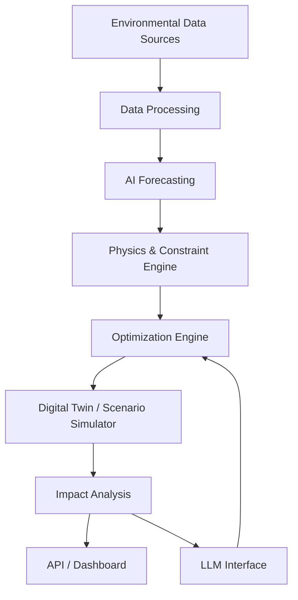

# EcoTwin

### Physics-Informed AI Digital Twin for Urban Waste & Energy Systems

> **Simulate environmental interventions before deploying them. Use AI to predict and optimize urban resource flows while physical constraints keep the system grounded in reality.**

**Project Status:** Proposed — implementation not yet started.

---

## Overview

Urban waste and energy systems are interconnected physical systems.

A change in household waste segregation can alter the amount of recyclable material recovered, collection requirements, processing loads, landfill diversion, transport energy, and environmental impact. The same principle can extend to waste-to-energy, rooftop solar, electric mobility, and public transport.

**EcoTwin** proposes a computational digital twin for these systems.

Instead of building another sustainability dashboard or asking an LLM to generate environmental recommendations, EcoTwin aims to model the underlying system and answer counterfactual questions such as:

> **What happens if household waste segregation increases from 40% to 70%?**

> **Can landfill use be reduced by 30% without increasing transport emissions?**

> **Where would additional recycling capacity have the greatest system-level impact?**

The proposed system combines:

- **AI** for forecasting and learning patterns from data
- **Physics and engineering models** for physical consistency
- **Optimization** for finding feasible interventions
- **Simulation** for evaluating counterfactual scenarios
- **LLMs** as a natural-language interface and explanation layer

The goal is not to predict the future perfectly. It is to build a useful, explainable model of how environmental interventions propagate through a city's resource system.

---

## The Problem

Environmental interventions are rarely isolated.

Consider a simple increase in waste segregation:

```text
Higher segregation
        ↓
Different waste composition
        ↓
More recoverable material
        ↓
Changed collection requirements
        ↓
Changed processing load
        ↓
Less material sent to landfill
        ↓
Changed transport + processing energy
        ↓
Changed emissions and resource recovery
```

A recommendation that looks beneficial at one stage can create a new constraint elsewhere.

For example:

- A recycling facility may improve recovery but become constrained by collection capacity.
- Increasing waste diversion may increase transport requirements.
- Sending organic waste to energy recovery changes both landfill flow and energy generation.
- A policy may reduce one emissions source while increasing another.

This creates a **system-level optimization problem**, not simply a classification or recommendation problem.

---

# Proposed Solution

EcoTwin models selected urban environmental flows as a computational system.

At a high level:

```text
              Environmental Data
                     │
                     ▼
              ┌──────────────┐
              │ AI Forecasts │
              └──────┬───────┘
                     │
                     ▼
        ┌──────────────────────────┐
        │ Physics / System Model   │
        │                          │
        │ Mass • Energy • Capacity │
        │ Transport • Conversion   │
        └────────────┬─────────────┘
                     │
                     ▼
              ┌──────────────┐
              │ Optimization │
              └──────┬───────┘
                     │
                     ▼
              Scenario Simulation
                     │
                     ▼
              Environmental Impact
```

The initial focus is **waste → material/energy recovery**, with an architecture that can later incorporate:

- e-waste
- informal recycling networks
- rooftop solar
- EV adoption
- public transportation

These are extensions rather than independent features.

---

# Why AI + Physics?

A purely data-driven model can learn correlations, but environmental systems obey physical and operational constraints.

For example, an unconstrained model should not be allowed to predict:

- more recovered mass than entered the system
- more energy output than the available energy permits
- a truck carrying more waste than its capacity
- a facility processing more waste than its throughput allows

EcoTwin therefore separates the responsibilities of AI and the physical model.

### AI

AI can learn or estimate:

- waste generation
- waste composition
- demand patterns
- environmental variables
- system dynamics
- candidate interventions

### Physics / Engineering Model

The physical layer can enforce:

- mass conservation
- energy constraints
- vehicle capacity
- facility capacity
- conversion efficiency
- transport requirements

### Optimization

The optimization layer can search for interventions that improve system-level objectives while respecting those constraints.

> **AI predicts. Physics determines what is feasible. Optimization determines what is preferable.**

---

# Core System

The proposed initial system focuses on the flow of municipal waste.

```text
┌──────────────────────────┐
│ Households / Businesses  │
└────────────┬─────────────┘
             │
             ▼
      Waste Generation
             │
             ▼
        Segregation
             │
     ┌───────┼────────┐
     ▼       ▼        ▼
 Recyclable Organic  E-waste
     │       │        │
     ▼       ▼        ▼
 Recycling  Biogas /  Material
  Recovery   Energy   Recovery
     │       │        │
     └───────┴────────┘
             │
             ▼
       Residual Waste
             │
             ▼
          Landfill
```

The system can eventually incorporate collection vehicles, processing facilities, energy recovery, and informal recycling networks as explicit nodes and constraints.

---

# Digital Twin

EcoTwin is intended to be a **simplified computational digital twin**, not a perfect replica of an entire city.

The model represents selected components of the real system:

| Component | Example representation |
|---|---|
| Waste sources | Households, businesses, wards |
| Waste streams | Organic, recyclable, e-waste, residual |
| Collection | Vehicles, routes, capacities |
| Processing | Recycling / organic-processing facilities |
| Recovery | Material and energy recovery |
| Disposal | Residual landfill flow |
| Energy | Energy consumed and recovered |
| Environment | Emissions and resource impact |

The digital twin allows users to modify parameters and compare:

**Baseline → Intervention → Simulated outcome**

---

# Physics & System Models

The exact physical models will be developed during implementation. The following represent the proposed modeling direction.

## Mass Balance

For a waste stream:

```text
Mass entering
=
Recovered material
+ Processed material
+ Landfilled material
+ Losses
```

Conceptually:

\[
M_{in} = M_{recovered} + M_{processed} + M_{landfill} + M_{loss}
\]

## Energy Balance

For an energy-recovery process:

\[
E_{out} \leq \eta E_{available}
\]

where:

- `E_available` is usable energy contained in the input stream
- `η` is conversion efficiency
- `E_out` is recoverable output energy

The exact formulation will depend on the selected conversion technology.

## Transport Constraints

Collection and transportation can be represented using constraints such as:

\[
Load \leq VehicleCapacity
\]

Transport energy can then be estimated from factors such as distance, payload, vehicle efficiency, and route characteristics.

## Facility Constraints

Processing facilities can be represented by throughput limits:

\[
ProcessingRate \leq FacilityCapacity
\]

These constraints become important when optimization attempts to redirect large amounts of waste toward a particular facility.

---

# AI Layer

AI is intended to handle the parts of the system where historical or observed data can provide useful predictive information.

Potential applications include:

### Waste Generation Forecasting

Predict waste generation as a function of:

- time
- location
- population
- historical patterns
- weather
- events or seasonal effects

### Waste Composition Prediction

Estimate the expected composition of incoming waste streams.

### Demand / Mobility Forecasting

For future extensions, predict:

- transport demand
- EV charging demand
- public transport demand

### Learned System Dynamics

Where sufficient data is available, machine-learning models may learn relationships that are difficult to explicitly model.

The exact model family will be selected based on data availability and evaluation results rather than assuming that a neural network is always the best solution.

---

# Optimization Layer

The system can formulate environmental planning as a constrained optimization problem.

A conceptual objective could be:

\[
\min_x
\left(
\alpha CO_2(x)
+
\beta TransportEnergy(x)
+
\gamma Landfill(x)
-
\delta MaterialRecovery(x)
-
\epsilon RenewableGeneration(x)
\right)
\]

subject to:

\[
MassBalance(x)=0
\]

\[
EnergyConstraints(x)\leq 0
\]

\[
CapacityConstraints(x)\leq 0
\]

\[
OperationalConstraints(x)\leq 0
\]

The coefficients and objective formulation are intentionally left open until system requirements and available data are established.

Possible optimization approaches include:

- Mixed-integer optimization
- Constraint programming
- Linear / nonlinear optimization
- Evolutionary optimization
- Reinforcement learning for sequential decision problems

The simplest valid method should be preferred over unnecessary complexity.

---

# LLM Interface

An LLM can provide a natural-language interface to the digital twin.

The LLM should **not** be responsible for inventing numerical environmental results.

Instead:

```text
User
 │
 │ "Reduce landfill use by 30%
 │  without increasing emissions."
 ▼
LLM
 │
 │ Structured objective + constraints
 ▼
Simulation / Optimization Engine
 │
 ▼
Physically constrained result
 │
 ▼
LLM
 │
 ▼
Human-readable explanation
```

This creates a clean separation between **natural-language reasoning** and **numerical simulation**.

---

# Example Scenario

Consider a hypothetical city ward.

### Baseline

```text
Household segregation: 40%
       ↓
Mixed waste collection
       ↓
Limited material recovery
       ↓
Higher residual waste
       ↓
Landfill
```

A user asks:

> **"Simulate increasing segregation to 70%."**

The proposed system would:

1. Interpret the intervention.
2. Modify relevant system parameters.
3. Forecast the resulting waste composition.
4. Recalculate material flows.
5. Apply mass and capacity constraints.
6. Recalculate transportation and processing requirements.
7. Estimate energy and environmental impacts.
8. Compare the intervention against the baseline.

The output would be a **scenario comparison**, rather than a single sustainability score.

No numerical result is claimed until the underlying model has been implemented and validated.

---

# Potential Outputs

The system is intended to eventually quantify metrics such as:

- landfill diversion
- recovered material
- waste processing requirements
- transport distance
- transport energy
- energy recovered
- renewable energy generated
- estimated emissions
- facility utilization
- intervention cost
- system-level trade-offs

The exact metrics will depend on available data and validated models.

---

# Research Hypothesis

A central research question is:

> **Can physics-constrained AI produce more reliable and physically plausible environmental intervention recommendations than unconstrained predictive models?**

A planned comparison is:

```text
Model A
AI-only prediction / optimization

          vs.

Model B
AI + physical constraints

          vs.

Model C
AI + physics-informed objectives / constraints
```

Potential evaluation dimensions include:

- predictive accuracy
- physical consistency
- constraint violations
- optimization quality
- robustness to unusual scenarios
- sensitivity to input changes

This is a **research hypothesis**, not a claimed result.

---

# Evaluation Plan

The project should be evaluated at three levels.

## 1. Predictive Performance

Where suitable datasets are available:

- train / validation / test performance
- forecasting error
- generalization to unseen periods or locations

## 2. Physical Consistency

Measure violations of:

- mass balance
- energy constraints
- facility capacity
- vehicle capacity
- other system constraints

## 3. Intervention Quality

Compare baseline and optimized scenarios using metrics such as:

- landfill reduction
- material recovery
- energy consumption
- emissions
- operational cost

Ablation experiments should evaluate the contribution of the physical constraint layer independently from the AI component.

---

# Technology Direction

The final technology stack will depend on the selected data and models.

A potential implementation stack is:

| Layer | Possible technology |
|---|---|
| Backend | Python / FastAPI |
| ML | PyTorch / scikit-learn / LightGBM |
| Optimization | OR-Tools / Pyomo / SciPy |
| Simulation | Custom Python simulation engine |
| LLM | Provider-agnostic LLM API |
| Database | PostgreSQL / appropriate time-series storage |
| Frontend | React / Next.js |
| Deployment | Docker + cloud infrastructure |

These are **technology directions**, not current dependencies.

The project should prefer the simplest technology capable of solving each component.

---

# Proposed Architecture



The architecture is intentionally modular so individual models can be replaced and evaluated independently.

---

# Development Roadmap

### Phase 1 — Minimal System Model

Build a deterministic waste-flow model covering:

- waste generation
- segregation
- material flows
- processing
- landfill

**Goal:** establish a working physical baseline.

### Phase 2 — Physics & Operational Constraints

Introduce:

- mass conservation
- energy constraints
- vehicle capacity
- facility capacity
- conversion efficiency

**Goal:** ensure simulated states remain physically and operationally feasible.

### Phase 3 — AI Forecasting

Introduce predictive models for:

- waste generation
- waste composition
- relevant environmental variables

**Goal:** replace static assumptions with data-driven predictions.

### Phase 4 — Optimization

Introduce constrained optimization for intervention planning.

**Goal:** automatically identify feasible improvements.

### Phase 5 — Digital Twin Interface

Build scenario creation and baseline-vs-intervention visualization.

**Goal:** make the model interactively explorable.

### Phase 6 — LLM Interface

Allow users to express environmental objectives in natural language.

**Goal:** turn the simulator into an accessible decision-support interface.

### Phase 7 — Validation & Experiments

Perform:

- model evaluation
- constraint-violation analysis
- ablation studies
- scenario robustness testing

**Goal:** establish whether the hybrid approach actually provides an advantage.

### Phase 8 — Extensions

Potentially extend the same framework to:

- rooftop solar
- EV adoption
- public transportation
- informal recycling networks
- broader urban energy flows

---

# Why This Is Different

EcoTwin is deliberately **not**:

- a garbage image classifier
- a generic sustainability chatbot
- a carbon calculator
- a static environmental dashboard
- an LLM that generates environmental statistics
- seven disconnected sustainability features

The proposed differentiator is the interaction between:

```text
AI prediction
      +
Physical system modeling
      +
Constrained optimization
      +
Counterfactual simulation
```

The objective is to move from:

> **"What should people do?"**

toward:

> **"If the system changes in this way, what physically happens, and what intervention produces the best feasible outcome?"**

---

# Future Extensions

The same architecture can eventually model additional environmental systems.

### Rooftop Solar

Estimate generation using:

- roof area
- irradiance
- panel efficiency
- orientation
- weather
- temperature

### EV Adoption

Model:

- vehicle energy demand
- charging demand
- charging infrastructure
- grid impact
- emissions trade-offs

### Public Transport

Model:

- passenger demand
- modal shifts
- vehicle utilization
- route-level energy use
- emissions per passenger

### Informal Recycling

Represent informal recyclers as nodes in the resource-recovery network and investigate their effect on:

- collection efficiency
- recovery rates
- transportation
- material flows

These extensions will only be pursued after the core waste-resource model is validated.

---

# Limitations & Assumptions

The initial system will necessarily simplify reality.

Important limitations may include:

- incomplete or synthetic datasets
- uncertain waste composition
- simplified conversion efficiencies
- incomplete representation of human behavior
- uncertain emissions factors
- geographic assumptions
- limited facility and route data
- model uncertainty
- imperfect representation of informal recycling networks

The project should expose these assumptions rather than hide them behind a single numerical score.

A useful digital twin is not defined by pretending to be perfectly accurate; it is defined by making its assumptions explicit and testing where its conclusions remain reliable.

---

# Project Goals

The project aims to demonstrate that environmental software can move beyond visualization and generic recommendations toward **simulation-based decision support**.

The primary goals are:

1. Build a physically grounded urban waste-resource model.
2. Integrate AI-based forecasting.
3. Introduce explicit physical and operational constraints.
4. Optimize environmental interventions.
5. Provide counterfactual scenario simulation.
6. Evaluate whether physics-constrained approaches improve reliability.
7. Create an architecture extensible to other urban environmental systems.

---

# Project Status

**Proposed — implementation not yet started.**

The architecture, mathematical formulations, model choices, datasets, and evaluation methodology are subject to refinement during implementation.

No performance claims or environmental impact numbers are currently asserted.

---

## License

License to be selected when implementation begins.
