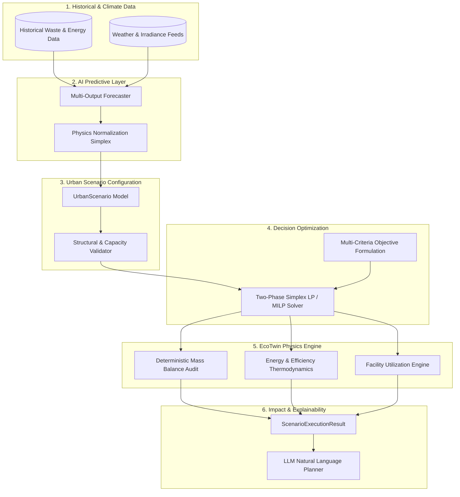

## Backend service (implemented)

The interactive city-planning simulator now supports custom-area clearing/filling,
before/after energy and waste balances, runoff, vegetation, regional air baselines
and reproducible exports. [Small architecture guide](docs/ARCHITECTURE.md) describes
the implemented scope, explicit scientific limits and Docker/AWS handoff.

The preserved EcoTwin scientific library now has a FastAPI/PostGIS backend, immutable
city snapshots, dataset import CLI, authenticated scenarios, recoverable worker jobs,
local/S3 object storage, screening runoff/PV models and AWS Terraform infrastructure.

```bash
python3 scripts/local.py up
```

Docker Compose v2 and Python 3.10+ are the only host runtime prerequisites.
The launcher downloads real inputs automatically; datasets are **not bundled**.
See [local/AWS deployment and storage](docs/DEPLOYMENT.md) and the
[fresh-clone agent prompt](docs/LOCAL_AGENT_PROMPT.md). Download slots and exact import steps:
[Dataset onboarding](docs/DATASETS.md). Setup, models and release limitations:
[Operations](docs/OPERATIONS.md). Cloud deployment: [Terraform runbook](infra/terraform/README.md).
Actual validation evidence: [Implementation report](docs/implementation-report.json).
Interactive city removal impacts, live forecast data and optional local Ollama:
[Removal previews](docs/REMOVAL_PREVIEWS.md).
The handoff guide pack is private and excluded from Git and Docker builds.

The original library overview below remains for compatibility. Its future-grid/EV/heat
examples are illustrative; the new backend supports only the explicitly documented models.

---

# EcoTwin 

### Physics-Informed AI Digital Twin for Urban Energy, Mobility & Resource Systems

> A computational digital twin for modeling, stress-testing, and optimizing interconnected urban systems before deploying interventions in the real world.


---

## Table of Contents

- [The Core Philosophy](#the-core-philosophy)
- [The Problem: Coupled Urban Dynamics](#the-problem-coupled-urban-dynamics)
- [The Solution: System-Level Digital Twin](#the-solution-system-level-digital-twin)
- [What the Platform Simulates](#what-the-platform-simulates)
- [System Architecture & Dataflow](#system-architecture--dataflow)
- [Mathematical & Physics Formulations](#mathematical--physics-formulations)
  - [1. Mass Conservation Law](#1-mass-conservation-law)
  - [2. Energy Balance & Recovery Physics](#2-energy-balance--recovery-physics)
  - [3. Grid & Transformer Capacity Bounds](#3-grid--transformer-capacity-bounds)
  - [4. Battery Storage & EV State-of-Charge Dynamics](#4-battery-storage--ev-state-of-charge-dynamics)
  - [5. Constrained Multi-Objective Optimization](#5-constrained-multi-objective-optimization)
- [Implementation Roadmap & Status](#implementation-roadmap--status)
- [Example Scenarios & Walkthroughs](#example-scenarios--walkthroughs)
  - [Scenario 1: Organic Waste-to-Energy Grid Support](#scenario-1-organic-waste-to-energy-grid-support)
  - [Scenario 2: EV Adoption vs. Evening Transformer Stress](#scenario-2-ev-adoption-vs-evening-transformer-stress)
  - [Scenario 3: 45°C Heatwave Resilience & Flexible Pre-Cooling](#scenario-3-45c-heatwave-resilience--flexible-pre-cooling)
- [Research Hypothesis & Evaluation Framework](#research-hypothesis--evaluation-framework)
- [Repository Structure](#repository-structure)
- [Quickstart & Execution Guide](#quickstart--execution-guide)
- [Why EcoTwin / EnergyTwin is Different](#why-ecotwin--energytwin-is-different)
- [Limitations & Explicit Assumptions](#limitations--explicit-assumptions)
- [License](#license)

---

## The Core Philosophy

Conventional sustainability tools ask: **"What happened in the past?"**  
Traditional machine learning models ask: **"What is likely to happen?"**  
**EcoTwin / EnergyTwin asks:**

> **"If we intervene in this urban system, what is physically possible, what trade-offs occur, and what intervention produces the optimal feasible outcome?"**

```
┌─────────────────────────────────────────────────────────────────────────────┐
│                             THE TRIAD OF TRUTH                              │
├──────────────────────────────┬─────────────────────────────┬────────────────┤
│         AI FORECASTS         │       PHYSICS GOVERNS       │  OPTIMIZATION  │
│      "What May Happen"       │     "What Can Happen"       │  "What Should" │
├──────────────────────────────┼─────────────────────────────┼────────────────┤
│ Machine learning models      │ Deterministic conservation  │ Multi-criteria │
│ learn temporal dynamics,     │ laws, capacity envelopes,   │ linear and     │
│ weather sensitivity, and     │ and thermodynamic limits    │ mixed-integer  │
│ stochastic urban behavior.   │ prevent hallucinated states.│ programming.   │
└──────────────────────────────┴─────────────────────────────┴────────────────┘
```

---

## The Problem: Coupled Urban Dynamics

Urban systems are not a collection of independent silos; they are tightly coupled physical networks. An intervention in one sector inevitably triggers cascading consequences across other sectors:

```text
Higher EV Adoption (20% → 50%)
       │
       ▼
Surge in Evening Charging Demand (6 PM – 9 PM)
       │
       ▼
Local Substation & Transformer Overload
       │
       ▼
Grid Stress & High-Carbon Peaker Plant Dispatch
       │
       ├──► Need for Smart Charging & Vehicle-to-Grid (V2G)
       └──► Need for Local Battery Storage & Waste-to-Energy Baselines
```

Similarly, on the generation and resource side:

```text
Increased Rooftop Solar PV (20 MW → 50 MW)
       │
       ▼
Midday Generation Exceeds Local Consumption
       │
       ▼
Reverse Power Flow & Grid Inverter Tripping
       │
       ▼
Massive Renewable Energy Curtailment
       │
       ├──► Need for Thermal Pre-Cooling of Buildings
       ├──► Need for Flexible Industrial & Water Pumping Loads
       └──► Opportunity for Daytime EV Fleet Opportunity Charging
```

Single-domain dashboards and isolated carbon calculators fail because they treat these coupled systems independently. **EcoTwin / EnergyTwin unifies them into a single computational system.**

---

## The Solution: System-Level Digital Twin

EcoTwin / EnergyTwin establishes a digital twin of an urban ward, campus, or municipality. It evaluates interventions through an end-to-end computational pipeline:

```text
                    USER INTERVENTION
             ("What if EV adoption rises to 50%
               and waste segregation hits 75%?")
                           │
                           ▼
                    AI FORECASTING
          (Forecast generation, demand profiles,
             and category fractions over time)
                           │
                           ▼
              PHYSICS & CONSTRAINT ENGINE
         (Audit mass conservation, energy limits,
             transformer caps, battery bounds)
                           │
                           ▼
             MULTI-OBJECTIVE OPTIMIZATION
        (Solve optimal routing, battery dispatch,
             and flexible load scheduling)
                           │
                           ▼
               ECOTWIN SIMULATION ENGINE
         (Calculate deterministic physical balance,
            landfill diversion, and grid flows)
                           │
                           ▼
                 EXPLAINABLE REPORTING
          (Quantify material recovery, emissions,
             energy yield, and capacity margins)
```

---

## What the Platform Simulates

```
                                  WEATHER & CLIMATE
                            (Temperature, Solar Irradiance)
                                          │
                                          ▼
                                ┌───────────────────┐
                                │   AI FORECASTS    │
                                └─────────┬─────────┘
                                          │
                                          ▼
                ┌───────────────────────────────────────────────────┐
                │                 URBAN ENERGY GRID                 │
                └───────┬───────────────┬───────────────────┬───────┘
                        │               │                   │
         ┌──────────────┴───────┐       │       ┌───────────┴──────────────┐
         ▼                      ▼       │       ▼                          ▼
  ┌──────────────┐     ┌──────────────┐ │ ┌──────────────┐        ┌──────────────┐
  │  Solar PV    │     │ Wind Turbine │ │ │ Battery ESS  │        │ Waste-to-    │
  │  Generation  │     │ Generation   │ │ │ (SOC / SOH)  │        │ Energy (WtE) │
  └──────────────┘     └──────────────┘ │ └──────────────┘        └──────────────┘
                                        │
     ┌──────────────────────────────────┴──────────────────────────────────┐
     │                                                                     │
     ▼                                  ▼                                  ▼
┌──────────────┐               ┌──────────────────┐               ┌──────────────────┐
│  Buildings   │               │ Electric Vehicle │               │ Resource / Waste │
│  (HVAC/Load) │               │ Fleet (V2G/Grid) │               │ Recovery Network │
└──────────────┘               └──────────────────┘               └──────────────────┘
```

The system models eight critical urban subsystems:

1. **Municipal Solid Waste (MSW) Streams:** Organic, recyclable, e-waste, and residual fractions tracked with explicit physical mass units (`kg`, `tonnes`).
2. **Materials Recovery & Recycling:** Sorting efficiencies, reject rates, contamination limits, and circular material recovery.
3. **Waste-to-Energy & Bio-Power:** Anaerobic Digestion (biogas yield, thermal conversion, methane content, net electricity) and Waste-to-Energy incineration plants (calorific LHV, steam turbine efficiency, bottom ash metal recovery).
4. **Renewable Energy Infrastructure:** Distributed rooftop solar PV, utility solar, and localized wind generation driven by climate and irradiance time series.
5. **Battery Energy Storage Systems (BESS):** Dynamic State-of-Charge ($SOC$), charging/discharging efficiency, round-trip losses, and degradation limits.
6. **Grid & Substation Infrastructure:** Peak load constraints, transformer thermal limits, reverse power flow monitoring, and grid import/export balances.
7. **Electrified Mobility & V2G:** Fleet arrival/departure schedules, required departure $SOC$, maximum charging power, and bidirectional vehicle-to-grid grid stabilization.
8. **Flexible Building & Cooling Demand:** Weather-sensitive HVAC cooling loads, indoor comfort bounds, pre-cooling flexibility, and industrial demand response.

---

## System Architecture & Dataflow

EcoTwin enforces strict architectural boundaries between predictive uncertainty, physical reality, and mathematical optimization:



---

## Mathematical & Physics Formulations

### 1. Mass Conservation Law

For every incoming municipal waste stream and processing node $j$, mass conservation is strictly maintained:

$$M_{\text{in}} = M_{\text{recovered}} + M_{\text{landfill}} + M_{\text{loss}}$$

For each individual waste category $c \in \{\text{Organic}, \text{Recyclable}, \text{E-Waste}, \text{Residual}\}$:

$$M_c = M_{\text{total}} \cdot f_c \quad \text{where} \quad \sum_{c} f_c = 1.0, \quad f_c \ge 0$$

Across all receiving facilities $k \in \mathcal{F}$:

$$\sum_{k \in \mathcal{F}} x_{c, k} = 1.0, \quad \forall c \quad \text{and} \quad \sum_{c} M_c \cdot x_{c, k} \le \text{Capacity}_k, \quad \forall k$$

### 2. Energy Balance & Recovery Physics

Recovered energy from thermal conversion or biochemical digestion is governed by first-principles thermodynamics:

$$E_{\text{recovered}} = \sum_{c} M_c \cdot x_{c, k} \cdot \text{LHV}_c \cdot \eta_{\text{conversion}}$$

where:
* $\text{LHV}_c$ is the Lower Heating Value / specific biogas energy content ($\text{kWh}/\text{tonne}$)
* $\eta_{\text{conversion}} \in [0.0, 1.0]$ is the net electrical/thermal conversion efficiency

### 3. Grid & Transformer Capacity Bounds

At any time step $t$, the net power balance across the urban substation must not exceed rated transformer headroom:

$$P_{\text{grid}}(t) = P_{\text{demand}}(t) + P_{\text{EV}}(t) + P_{\text{battery,charge}}(t) - P_{\text{solar}}(t) - P_{\text{WtE}}(t) - P_{\text{battery,discharge}}(t) - P_{\text{V2G}}(t)$$

$$\left| P_{\text{grid}}(t) \right| \le P_{\text{transformer,max}}$$


### 4. Battery Storage & EV State-of-Charge Dynamics

Battery Energy Storage Systems and EV fleets operate within physical $SOC$ envelopes:

$$SOC(t+1) = SOC(t) + \left( \eta_{\text{charge}} \cdot P_{\text{charge}}(t) - \frac{P_{\text{discharge}}(t)}{\eta_{\text{discharge}}} \right) \cdot \Delta t$$

$$SOC_{\min} \le SOC(t) \le SOC_{\max}$$

### 5. Constrained Multi-Objective Optimization

The optimization engine searches for the optimal decision vector $x^*$ (routing splits, storage dispatch, flexible load shifts) that maximizes total system utility:

$$\max_{x} \quad \mathcal{J}(x) = w_{\text{mat}} \cdot \frac{M_{\text{recovered}}(x)}{M_{\text{total}}} - w_{\text{landfill}} \cdot \frac{M_{\text{landfill}}(x)}{M_{\text{total}}} + w_{\text{energy}} \cdot \frac{E_{\text{recovered}}(x)}{E_{\text{ref}}} - w_{\text{cost}} \cdot \text{Cost}(x) - w_{\text{peak}} \cdot P_{\text{peak}}(x)$$

$$\text{Subject to:} \quad \mathbf{A}_{\text{eq}} x = \mathbf{b}_{\text{eq}}, \quad \mathbf{A}_{\text{ub}} x \le \mathbf{b}_{\text{ub}}, \quad 0 \le x \le 1$$

---

## Implementation Roadmap & Status

| Phase | Milestone | Scope & Capabilities | Status |
|---|---|---|---|
| **Phase 1** | **Deterministic Physics Engine** | Core mass & energy balance models, explicit `Mass` and `Energy` unit types, category taxonomy, processing profile physics closure. | ✅ **Completed** |
| **Phase 2** | **Urban Scenarios & Baselines** | `UrbanScenario` configuration, physical constraint validation, capacity verification, and synthetic metropolis baselines (`generate_baseline_scenario`). | ✅ **Completed** |
| **Phase 3** | **AI Forecasting Layer** | Autoregressive multi-output Ridge regressor with lag, trend, and cyclical calendar features. Simplex projection ensuring mass/fraction conservation. | ✅ **Completed** |
| **Phase 4** | **Routing Optimization** | Two-Phase Simplex Linear Programming optimizer for multi-criteria waste routing under capacity and compatibility bounds. | ✅ **Completed** |
| **Phase 5** | **Grid & BESS Integration** | Power flow balance, transformer headroom modeling, solar PV generation, and battery charge/discharge scheduling. | 🔄 *Next* |
| **Phase 6** | **EV Fleet & V2G Coordination** | Dynamic EV fleet arrival/departure scheduling, smart charging delay windows, and bidirectional V2G grid peak shaving. | 📋 *Planned* |
| **Phase 7** | **Heatwave & Resilience Mode** | 45°C extreme heatwave simulation, building cooling demand response, HVAC pre-cooling flexibility, and emergency load shifting. | 📋 *Planned* |
| **Phase 8** | **LLM Planning Interface** | Natural-language objective parser converting policy prompts (e.g., *"Cut peak load by 20% without violating comfort"*) into structured optimization models. | 📋 *Planned* |

---

## Example Scenarios & Walkthroughs

### Scenario 1: Organic Waste-to-Energy Grid Support
* **Baseline:** Mixed organic waste is sent to a low-efficiency municipal incinerator (10% recovery, 20% landfill).
* **AI Forecast:** Identifies a 398-tonne seasonal surge in food waste during summer.
* **Optimization Decision:** Two-Phase Simplex routes 300 tonnes (100% capacity) to high-yield Composting and the remaining 98.14 tonnes to Anaerobic Digestion.
* **Physical Outcome:**
  * Material Recovery increases by **+30.28 tonnes** (+3.14% recovery rate).
  * Generates **178.99 MWh** of clean bio-power.
  * Mass balance strictly preserved ($\Delta M = 0.000000\text{ kg}$).

### Scenario 2: EV Adoption vs. Evening Transformer Stress
* **Scenario:** Neighborhood EV adoption surges from 20% to 50% (500 vehicles charging between 6 PM and 9 PM).
* **Unconstrained Simulation:** Evening grid load exceeds local 2.5 MVA substation capacity by 35% (overload condition).
* **EcoTwin Intervention:** Smart charging schedules shift non-critical charging to 11 PM – 4 AM while drawing 150 kWh from available V2G-enabled vehicles during the 7 PM peak.
* **Physical Outcome:** Grid peak load reduced by 28%; transformer loading drops to 84% (safe operating margin).

### Scenario 3: 45°C Heatwave Resilience & Flexible Pre-Cooling
* **Scenario:** Ambient temperature climbs from 34°C to 45°C during an extreme heat event.
* **AI Forecast:** Predicts a 42% spike in building HVAC cooling demand coinciding with solar irradiance peaks.
* **Optimization Intervention:** Triggers building thermal pre-cooling at 1:30 PM using midday solar surplus; curtails non-essential cooling by 1.5°C during the 5 PM – 7 PM grid peak.
* **Physical Outcome:** Prevents blackout without violating indoor thermal comfort envelopes ($21^\circ\text{C} \le T_{\text{indoor}} \le 25^\circ\text{C}$).

---

## Research Hypothesis & Evaluation Framework

```text
Model A (AI-Only)          vs.          Model B (AI + Physics)          vs.          Model C (AI + Physics + Optimization)
Pure neural network                      Machine learning with                        AI forecasting with deterministic
black-box prediction                     mass/energy boundary checks                  physics closure and LP/MILP optimization
```

### Evaluation Dimensions:
1. **Predictive Performance:** Mean Absolute Error (MAE), RMSE, and generalization across unseen seasonal cycles.
2. **Physical Consistency Violations:** Frequency and magnitude of mass leaks ($\Delta M \ne 0$), negative energy generation, and capacity breaches.
3. **Intervention Feasibility:** Measure whether recommended policy interventions can be physically deployed without violating operational envelopes.

---

## Repository Structure

```text
EnvironmentHacks/
├── ecotwin/                        # Core EcoTwin Library
│   ├── __init__.py                 # Clean package API exports
│   ├── units.py                    # Explicit Mass, Energy, and SpecificEnergy units
│   ├── categories.py               # WasteCategory taxonomy (Organic, Recyclable, etc.)
│   ├── stream.py                   # WasteStream model & simplex composition logic
│   ├── facility.py                 # ProcessingFacility & CategoryProcessingProfile
│   ├── routing.py                  # RouteSplit and RoutingPlan distribution
│   ├── balance.py                  # EcoTwinEngine & SystemBalanceResult physics audit
│   ├── scenario.py                 # UrbanScenario model & ScenarioExecutionResult
│   ├── synthetic.py                # Deterministic synthetic city baseline generators
│   ├── forecasting.py              # ML Ridge forecaster & physical constraint normalizer
│   ├── optimization.py             # Two-Phase Simplex LP optimizer & OptimizationResult
│   └── exceptions.py               # Domain exception hierarchy (PhysicsViolationError, etc.)
├── examples/                       # Executable Pipeline Demonstrations
│   ├── basic_scenario.py           # Phase 1: Physical mass/energy balance closure
│   ├── baseline_scenario.py        # Phase 2: Synthetic city baseline execution
│   ├── forecasting_pipeline.py     # Phase 3: Historical data -> Forecast -> Simulation
│   └── optimization_pipeline.py    # Phase 4: Forecast -> LP Routing Optimization -> Physics
├── tests/                          # Comprehensive Unit & Integration Test Suite
│   ├── test_units.py               # Unit conversion, arithmetic & boundary tests
│   ├── test_stream.py              # Simplex composition & stream split/combine tests
│   ├── test_facility.py            # Facility profile conversion & capacity tests
│   ├── test_routing.py             # Route splitting & compatibility tests
│   ├── test_balance.py             # Global mass/energy balance closure integration
│   ├── test_scenario.py            # Scenario validation & execution tests
│   ├── test_synthetic.py           # Synthetic generator reproducibility tests
│   ├── test_forecasting.py         # AI forecaster, lag features & normalization tests
│   └── test_optimization.py        # Two-Phase Simplex LP solver & routing optimization tests
└── README.md                       # Comprehensive Platform Documentation
```

---

## Quickstart & Execution Guide

### 1. Run the Complete Test Suite
The repository includes 49 comprehensive unit and integration tests covering physics invariants, AI forecasting, and optimization solvers:

```bash
python3 -m unittest discover tests
```
```text
.................................................
----------------------------------------------------------------------
Ran 49 tests in 0.235s

OK
```

### 2. Run the End-to-End Forecasting & Optimization Pipeline
Executes the full Phase 1 $\to$ Phase 4 pipeline (365-day synthetic history $\to$ ML forecaster $\to$ constrained forecast $\to$ baseline scenario $\to$ Two-Phase Simplex LP optimization $\to$ EcoTwin physical simulation):

```bash
python3 examples/optimization_pipeline.py
```

#### Sample Output:
```text
==========================================================================
 EcoTwin Phase 4: Waste Forecasting & Routing Optimization Pipeline
==========================================================================

[Step 1] Generating Synthetic Historical Waste Dataset (365 days)...
  * Generated 365 daily observations (2025-01-01 to 2025-12-31)

[Step 2] Training ML Forecaster on Historical Dynamics...
  * Model trained successfully on lag, trend, and cyclical calendar features.

[Step 3] Predicting Next-Day Urban Waste Generation & Composition...
  * Forecast Date        : 2026-01-01
  * Predicted Total Waste: 965.80 tonnes
  * Predicted Composition:
      - organic     :  398.14 tonnes (41.22%)
      - recyclable  :  233.48 tonnes (24.18%)
      - e-waste     :   55.76 tonnes ( 5.77%)
      - residual    :  278.42 tonnes (28.83%)

[Step 4] Configuring Urban Facilities & Baseline Scenario...
[Step 5] Optimizing Waste Routing via Linear Programming (Two-Phase Simplex)...

[Step 6] Execution & Physical Balance Comparison:
==========================================================================
 EcoTwin Waste-Routing Optimization Report: Metropolis_Beta_Unoptimized
==========================================================================
  * Solver Status       : OPTIMAL (Two-Phase Simplex LP)
  * Baseline Score      : 0.8107
  * Optimized Score     : 0.8476 (Score Improvement: +0.0369 / +4.55%)

[System-Level Metrics Comparison]
  Metric                         | Baseline     | Optimized    | Delta     
  -------------------------------|--------------|--------------|-----------
  Landfill Residue (tonnes)      |     138.89 t |     138.89 t |    +0.00 t
  Landfill Diversion Rate        |      85.62 % |      85.62 % |    +0.00 %
  Material Recovered (tonnes)    |     512.58 t |     542.85 t |   +30.28 t
  Material Recovery Rate         |      53.07 % |      56.21 % |    +3.14 %
  Energy Recovered (MWh)         |     191.26   |     178.99   |   -12.27 MWh
  Mass Balance Error (kg)        |   0.000000 kg|   0.000000 kg| 0.000000 kg

[Facility Capacity Utilization Comparison]
  Facility                       | Baseline     | Optimized   
  -------------------------------|--------------|-------------
  Composting_Center              |       66.4 % |      100.0 %
  Anaerobic_Digestion_Plant      |       56.9 % |       28.0 %
  Materials_Recovery_Facility    |       58.4 % |       58.4 %
  E_Waste_Hub                    |       55.8 % |       55.8 %
  Waste_to_Energy_Plant          |       69.6 % |       69.6 %
==========================================================================

[Optimized Category Routing Decisions]
  * organic      -> Composting_Center (75.3%), Anaerobic_Digestion_Plant (24.7%)
  * recyclable   -> Materials_Recovery_Facility (100.0%)
  * e-waste      -> E_Waste_Hub (100.0%)
  * residual     -> Waste_to_Energy_Plant (100.0%)
```

---

## Why EcoTwin / EnergyTwin is Different

```
┌──────────────────────────────────────┬──────────────────────────────────────┐
│       TRADITIONAL SUSTAINABILITY     │       ECOTWIN / ENERGYTWIN           │
├──────────────────────────────────────┼──────────────────────────────────────┤
│ ❌ Static historical dashboards       │ ✅ Counterfactual forward simulation  │
│ ❌ Unconstrained black-box AI        │ ✅ Physics-informed conservation laws│
│ ❌ Generic sustainability checklists │ ✅ Multi-objective LP/MILP solutions │
│ ❌ Isolated domain calculations      │ ✅ Interconnected grid/waste/mobility│
│ ❌ LLM hallucinations of numbers     │ ✅ LLM as reasoning & explanation UI │
└──────────────────────────────────────┴──────────────────────────────────────┘
```

---

## Limitations & Explicit Assumptions

A trustworthy digital twin makes its modeling assumptions fully transparent:

1. **Synthetic Benchmark Datasets:** Historical time series and city profiles are algorithmically synthesized for benchmark testing and do not claim to represent specific empirical municipality records.
2. **Simplified Grid Linearization:** Current power flow models assume balanced three-phase operation and linear substation headroom.
3. **Deterministic Conversion Profiles:** Facility conversion efficiencies and recovery fractions are treated as piecewise-linear profiles subject to capacity ceilings.
4. **Behavioral Approximations:** Human compliance with waste segregation and EV charging arrival times are modeled with statistical distributions.

---

## License

This project is licensed under the **MIT License** — see the [LICENSE](LICENSE) file for details.
