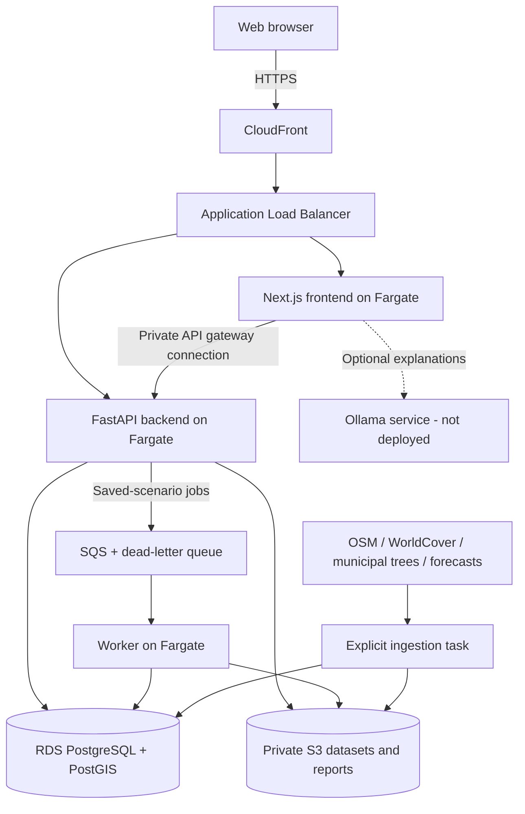

  

# EcoTwin

**Explore the environmental trade-offs of changing a real city.** EcoTwin combines
mapped urban features, public datasets, and transparent scientific calculations
to compare small interventions before committing to a detailed site assessment.

**[Open the deployed application](https://dl65r09hy25vj.cloudfront.net)** — AWS
staging deployment in Mumbai (`ap-south-1`). The public planner requires no sign-in.

The current study covers central Zurich. Select a building, tree, road, or park,
or draw an area to explore clearing, filling, and supported ground-cover changes.
Results show the assumptions, evidence, and data gaps behind each estimate.

## What EcoTwin does

- **Interactive planning:** inspect mapped features, adjust assumptions, and
  compare before/after intervention previews on the same map.
- **Environmental screening:** estimate supported changes in runoff, vegetation,
  building energy and waste proxies, demolition material balance, fill volume,
  and indicative solar opportunity when the required inputs are available.
- **Weather and air context:** display forecast inputs and regional air data with
  freshness, coverage, and source information.
- **Reproducible reports:** export geometry, inputs, model version, dataset
  references, results, limitations, and integrity hashes as JSON. The replay tool
  checks hashes and recalculates results from captured inputs.

Missing measurements are reported explicitly. Numerical impacts come from
deterministic models; optional AI explanations use their existing findings.

## Practical use cases, impacts, and benefits

| Planning question | How EcoTwin helps | Practical benefit |
| --- | --- | --- |
| What might change if this tree or building is removed? | Compare supported vegetation, runoff, material, and roof-solar indicators under stated assumptions. | Make trade-offs visible and identify what a site survey must verify. |
| Could a paved courtyard or parking area become greener? | Draw a bounded area and compare supported ground-cover changes and runoff screening. | Structure early discussions about landscaping and drainage investigations. |
| Which roofs deserve a solar assessment? | Inspect mapped footprints and indicative solar opportunity using explicit usable-area and performance assumptions. | Shortlist buildings for installer and structural surveys. |
| How can residents discuss redevelopment alternatives? | Share previews and reports with visible evidence and limitations. | Give stakeholders a common basis for discussing assumptions and missing data. |
| Where should a campus or municipality collect better data? | Inspect coverage gaps and uncertain inputs. | Prioritize tree inventories, soil sampling, roof inspections, and source updates. |

These are potential workflows, not documented customer deployments. EcoTwin makes
comparisons auditable, connects several environmental indicators in one interface,
and helps teams decide what to measure next. It does not yet have measured evidence
that its use has reduced emissions, flooding, planning costs, or health risks.

## Architecture

The frontend uses Next.js, React, and MapLibre for the map. FastAPI validates
selections and runs bounded calculations. PostGIS handles spatial queries; S3
retains source files and reports. The public planner uses read-only previews;
the retained protected scenario workflow has a background worker and queue.

Docker builds separate backend and frontend `linux/amd64` images. They are pushed
to ECR and deployed by immutable SHA256 digest. The backend image also supplies
worker, migration, and ingestion tools. Terraform manages the AWS resources.

### AWS services and their roles

| Service | Use in this deployment |
| --- | --- |
| CloudFront and Application Load Balancer | Provide the public HTTPS URL and route frontend/API requests. Application responses are not cached by CloudFront. |
| ECS on Fargate and ECR | Run application containers and retain separate release images. |
| RDS PostgreSQL with PostGIS | Store geometry, source revisions, published snapshots, and application/job records in a private encrypted database. |
| S3 | Store verified raw/processed inputs, manifests, and reports in a private, encrypted, versioned bucket. |
| SQS | Carry saved-scenario job messages; retain repeatedly failing messages in a dead-letter queue. |
| Cognito, Secrets Manager, and IAM | Protect backend operations, supply separate database-role credentials, and limit service permissions. Public previews require no sign-in. |
| VPC, security groups, NAT, and Cloud Map | Keep database/application tasks private, control access, allow provider downloads, and resolve the internal API address. |
| CloudWatch, WAF, and EventBridge Scheduler | Collect logs/alarms, apply request-rate limits, and import weather every three hours. |

### Why these architectural choices

- **Separate compute and persistent data:** Fargate disks are temporary. Source
  files live in S3, while searchable spatial data live in RDS. Scientific datasets
  stay outside Git and application images; the generated tree visualization asset
  is included in the frontend image.
- **Separate frontend, API, and worker:** interface delivery, preview requests,
  and queued jobs have different resource and release needs. The services can
  operate and scale independently.
- **Versioned inputs and deterministic calculations:** immutable revisions and
  captured forecast samples support repeatable reports. Refreshes create new
  revisions rather than changing the evidence behind old results.
- **Private service access:** the frontend reaches the API through private
  discovery. The database and scientific bucket are inaccessible to anonymous
  browser clients; separate database roles limit each service's write access.
- **CloudFront without a custom domain:** AWS supplies the hostname and browser
  TLS certificate. CloudFront-to-load-balancer traffic currently uses HTTP,
  restricted by the CloudFront network prefix list and a secret origin header.
  A custom domain with ACM is the path to TLS on both network legs.

## Data and current coverage

The Zurich study uses OpenStreetMap, ESA WorldCover 2021 v200, the municipal tree
register, Open-Meteo weather, and regional CAMS/Open-Meteo air forecasts. At initial
deployment it contained **18,866 mapped features, 57,600 land-cover cells, and
4,398 municipal trees**, plus weather and air forecast samples.

The analysis boundary is `8.53,47.37,8.55,47.39`. The map can show a wider city,
but that does not extend the scientific snapshot's coverage. Map tiles and imagery
are fetched on demand and depend on external providers.

Download recipes are in [the dataset configuration](config/datasets/zurich.json).
Source manifests preserve acquisition details, licenses, and content hashes.
Licenses differ: OSM has ODbL attribution/share-alike obligations; WorldCover is
CC BY 4.0. See [the dataset guide](docs/DATASETS.md) before redistributing data or
using provider services commercially.

## Optional Ollama explanations

Ollama can run a local or separately hosted language model to organize and rank
findings already produced by EcoTwin. A restricted output format prevents it from
changing calculated impacts or adding free-form numerical predictions.

**Ollama is not enabled on the current AWS deployment.** Maps, calculations, and
exports work without it. An operator can connect a separately secured service;
the supported default model is `qwen2.5:1.5b`. Ollama and its weights are separate
from Python requirements and application images. See [the explanation documentation](docs/REMOVAL_PREVIEWS.md)
for its behavior and configuration.

## Limitations

- **Early screening:** field verification and local professional assessment are
  needed before engineering, permitting, or investment decisions.
- **Incomplete and dated inputs:** mapped features may be missing or outdated;
  WorldCover describes 2021 cover. Some energy, waste, soil, and vegetation inputs
  are editable assumptions or literature proxies rather than site measurements.
- **Model boundaries:** runoff screening does not predict flood depth or drainage
  performance. Solar screening does not establish shading, roof strength, or
  guaranteed yield. Vegetation proxies are not a calibrated local carbon inventory.
- **Air and weather scale:** regional forecasts cannot establish intervention-caused
  changes in street pollution, temperature, health, biodiversity, or river chemistry.
- **Operational scope:** staging uses single-AZ RDS and seven-day backups.
  Large-scale load tests, a cloud restore drill, and the authenticated saved-scenario
  queue workflow were not part of deployment verification. Running AWS services
  incur ongoing costs.
- **Reproducibility has limits:** hashes and matching replay calculations establish
  internal consistency, not the accuracy of source measurements.

The deployed app passed four live browser tests covering map navigation, public
access boundaries, municipal-tree selection, and custom-area planning/export.
An exported report replayed successfully. These checks demonstrate working
software, not local scientific calibration. [Architecture notes](docs/ARCHITECTURE.md)
describe the detailed model and evidence boundaries.

## Future scope

Directions for future work include extending verified study coverage, calibrating
proxies with local measurements, improving roof/shading and drainage inputs, and
evaluating how the tool helps real planning teams.

Operational improvements include a secured Ollama service, a custom domain with
end-to-end TLS, production database resilience, load/queue testing, backup restore
exercises, and cost tuning. Detailed heat, air-quality, biodiversity, or hydraulic
models require suitable local data and independent validation before their outputs
can be presented as supported predictions.

The [AWS deployment record](docs/AWS_DEPLOYMENT_RECORD.md) contains the exact
deployment process, release identifiers, and verification evidence.
[The deployment guide](docs/DEPLOYMENT.md) covers infrastructure updates.

## License

See [LICENSE](LICENSE). Dataset and imagery licenses are separate from the code
license; follow each provider's attribution and redistribution requirements.
