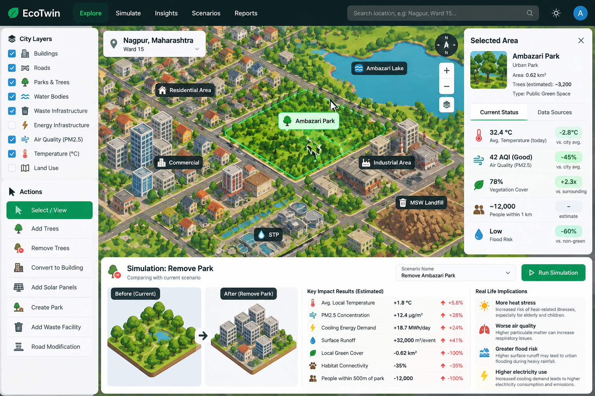
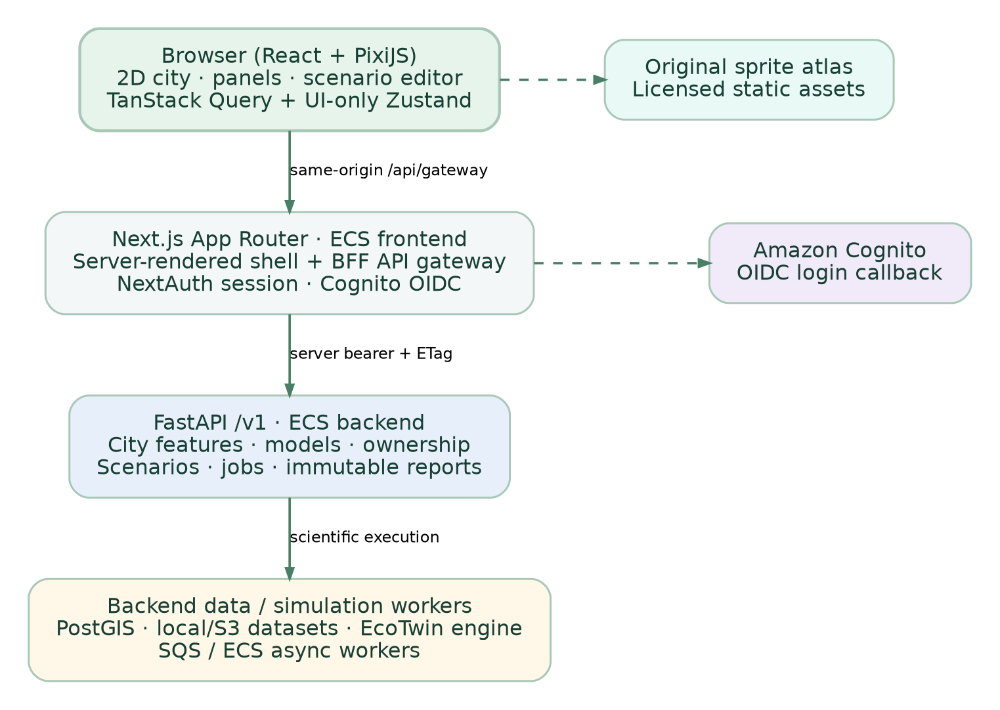

# EcoTwin Frontend — Agent Implementation Specification

**Edition:** 9 October 2026  
**Status:** Implementation contract for a coding agent and engineering reviewer  
**Scope:** Complete production-oriented user-facing web application, minimal frontend-specific server routes, tests and Docker/AWS deployment. **Do not rewrite the EcoTwin scientific/backend engines.**  
**Companion contract:** `EcoTwin_Backend_Agent_Implementation_Guide.md` — the `/v1` OpenAPI specification and scientific integrity rules are authoritative.

> **Non-negotiable:** Build an executable, responsive, accessible application. No static mock dashboards, fake simulation percentages, hardcoded city objects standing in for live backend geometry, demo data presented as measurements, inert controls, TODOs, `NotImplementedError`, invented API fields, or untested deploy commands. External Cognito credentials, backend availability, DNS, and AWS resources cannot be fabricated. Report real verified tests and blockers accurately.

## 0. Agent operating instructions and success definition

1. Inspect `EnvironmentHacks` repo, backend OpenAPI snapshot, `.env.example`, existing `frontend/`, Docker configuration and the supplied UI concept image **before editing**. Do not overwrite backend modules; preserve the already-working backend test suite.
2. Ensure `/v1` endpoints exist in backend OpenAPI or block the dependent UI path. Generate `frontend/src/lib/api/api-types.ts` from that spec, not from hand-written guesses. Preserve the backend companion's expected `frontend/src/lib/api-types.ts` via a checked-in re-export or adapt the backend codegen task without breaking its test.
3. Build a polished, game-like 2D city *viewer and scenario editor*; every editable action must correspond to a supported backend command. Any not-yet-supported operations are shown as disabled, explicitly labeled future capabilities, or omitted. Never send unknown scenario edit types.
4. Use **actual backend data** for maps, sensors, scenario revisions, and computed results. The previous EcoTwin prototype screenshot is **visual inspiration only**: its tree counts, temperature differences, PM2.5 consequences and claims of wildlife effects are not evidence.
5. Deliver full frontend repo, complete file implementations, Dockerfile, development compose integration, AWS IaC additions, automated test suite, CI, deployment runbook and a machine-readable acceptance report. Do not claim production deployment was completed without account access and successful live checks.
6. New repository contributors must be able to start the frontend and backend locally with documented commands, without access to AWS. Use container-local environment variables for runtime API access; do not require cloud storage detection in the browser.
7. TypeScript `strict: true`, `noUncheckedIndexedAccess: true`, no `any` escapes in domain/API code; use dependency lockfiles, a pinned secure runtime, browser integration tests, accessibility tests, error boundaries and visible provenance.

**In-scope complete flows:** application shell; city discovery; detailed city map; selectable geographic objects and areas; geographic/weather/air/land-cover overlays; city data provenance; authentication; scenario creation; land-cover polygon intervention; solar PV intervention; conditional waste-routing form; ETag-safe scenario edits; simulation submission; queued job tracking/cancellation; reports and repeatable baseline comparisons; error/unavailable states; shareable city-scoped URLs without disclosing private results; responsive layout; Docker and AWS release pipeline.

**Out of scope:** new scientific models, arbitrary planting of individually identifiable trees without inventory/operation support, precise street-level PM2.5 prediction, standalone ecological/health outcomes, live traffic animation based on inferred traffic, unrestricted drawing outside the study boundary, replacing OSM licensing rules, fake demo results, frontend-side scientific simulation or generating city raster imagery with LLMs.

### 0.1 Required measurable release gates

- Real browser journey: open city → see viewport geometry → select polygon → stage a valid land-cover edit → create/save scenario → run `landcover_summary` and `runoff_screen` → poll job → compare evidence-tagged results; no hardcoded report values.
- Authentication: user A cannot see user B's scenarios; tokens never enter browser JavaScript; logout revokes frontend session; production rejects development auth configuration.
- No contradictions with backend capabilities: unsupported metrics display *Unavailable* and their backend reason, not zero; stale sensor observations visibly marked with source timestamp; percentages omitted when baseline zero or unknown.
- Map: up to 5,000 bounded GeoJSON features per request; query only visible bbox; throttle pan/zoom and cancel stale requests; selectors work on touch and mouse; no canvas-context leaks on route changes.
- Quality: `npm ci`, `npm run lint`, `npm run typecheck`, `npm run test`, `npm run build`, `npm run test:e2e`, and Docker smoke tests pass. CI must generate types and reject API schema drift. Measure p95 UI time, canvas frame rate and frontend error rate on target equipment; never assert unmeasured performance.
- Accessibility: WCAG 2.2 AA target for DOM controls, forms, content, contrast, keyboard navigation and reduced-motion mode. Provide an accessible list/table alternative to canvas features.

## 1. Target interaction, style and screen layout

**Visual direction:** comfortable, richly detailed 2D/top-down city-building style inspired by Township and SimCity, with forest-green and teal accents, soft neutral surfaces, unobtrusive shadows, deliberate spacing and a bright, animated yet scientifically restrained urban map. Render geographic reality from GeoJSON; reuse a consistent, properly licensed atlas of building/park/water/tree/waste/solar symbols. Map markers must correspond to known features, not decoratively invented civic assets.

{width=6.25in}

**Desktop structure:** full-height top navigation (logo, Explore, Simulate, Insights, Scenarios, Reports, city selector, session menu), collapsible left layer/action rail (280 px), central GPU-accelerated city canvas, collapsible right contextual inspector (320 px), and resizable bottom result/scenario drawer. Do not consume viewport with excessive dashboard charts. Make the map the main object.

**Mobile/tablet:** map remains the primary viewport; layers become a drawer, inspect/edit panel becomes bottom sheet, map tools use minimum 44×44 CSS px targets; preserve keyboard and screen-reader alternatives; no horizontal page overflow at 375 px CSS width. For screen widths below 900 px avoid simultaneous two fixed sidebars.

**Navigation and routes:**

| Route | Function | Data source / behavior |
|---|---|---|
| `/` | Landing, explanation, CTA to Explore | Static marketing text; no fake impact statistics |
| `/explore` | City directory / search and coverage | `GET /v1/cities` with pagination |
| `/city/[cityId]` | City viewer and observations | city details, bbox features, land cover, sensor data, dataset register |
| `/city/[cityId]/simulate` | Interactive scenario lab | selected city, models, authenticated scenario edit workflow |
| `/scenarios/[scenarioId]` | Review an owned scenario | `GET /v1/scenarios/{id}`, optional report history |
| `/results/[resultId]` | Immutable simulation report | `GET /v1/results/{id}` requiring ownership |
| `/account` | Account identity and sign-out | Cognito via server-side session; no frontend database |
| `/data-methodology` | Evidence, uncertainty and source help | Static explanations plus current city source metadata |
| `/status` | Frontend/backend connectivity | Frontend `/api/health` and backend `/readyz`, never hide failure |

**Controls:** search city list by available registered names only (do not claim geocoding of arbitrary place names); layers Buildings, Roads, Parks/Vegetation, Water, Waste Facilities, Air Monitor Stations, Weather Overview, Land Cover, optional Landsat Surface Temperature. Disable a layer if absent in `/v1/cities/{city_id}/datasets` or `/v1/models`. Do not label Landsat *air temperature* or an unmeasured heat consequence *temperature improvement*.

## 2. Frontend technology stack — fixed responsibility

| Technology | Assigned implementation role | Reason and prohibition |
|---|---|---|
| **Next.js 15 App Router** + **React** + **TypeScript** | Site routes, server BFF, SSR of shell, session-controlled routes | Docker standalone SSR requires runtime Node server. Choose a patched, compatible 15.x release and commit lockfile; not static-export/S3-only. |
| **Node.js 22 LTS** + npm `package-lock.json` | Build/runtime/toolchain | Reproducible CI and container deployment. Pin Node base image digest in release workflow. |
| **PixiJS 8** | GPU-backed 2D city renderer, sprites, tile/camera layers, pointer selection | Prefer canvas for many graphical features; keep forms/labels in accessible DOM overlay. Pixi v8 uses async `Application.init()`. |
| **Tailwind CSS** + **shadcn/ui / Radix primitives** | Polished navigation, dialogs, sliders, forms and sheets | Reusable accessible controls; avoid rebuilding ARIA primitives. |
| **TanStack Query 5** | API request lifecycle, caching, cancellation, polling & invalidation | Avoid ad-hoc useEffect fetch chains; do not duplicate server truth in global state. |
| **Zustand** | Ephemeral camera, panel state, active layers, selected IDs, draft edits | Never replace backend scenarios/results with local-authoritative state. |
| **openapi-typescript + openapi-fetch** | Generated request/response types and server-only typed API client | Prevent schema drift and phantom API properties. |
| **Zod** | Validate frontend env, route params, form constraints and persisted UI preferences | Runtime defense; backend remains authority on geometry/domain constraints. |
| **proj4** + **Turf.js (limited)** | WGS84 ↔ projected viewport coordinates, UI polygon operations | UI geometry only; scientific area calculations remain in backend projected CRS. |
| **Recharts** | Modest evidence-labeled metric charts and baseline deltas | No invented series or visual interpolation into faux observations. |
| **NextAuth.js v4** with **Cognito OIDC** | Server-side authentication and encrypted HttpOnly session cookies | Stable major. Explicit JWT access token refresh callback; do not expose tokens in session JSON/browser. Verify chosen patched 4.x works with pinned Next.js. |
| **Vitest + Testing Library + MSW + Playwright + axe-core** | Units, components, contract mocks, E2E and accessibility checks | Deterministic tests over recorded/contract-matching fixtures. |
| **Docker + ECR + ECS Fargate** | Multi-stage immutable image, AWS deployment | Frontend shares release workflow with backend but has separate ECR repo/service. |

**Optional only after measured need:** MapLibre for conventional vector-tile basemap, workers for expensive GeoJSON tessellation, Sentry-compatible error tracking, CloudFront distribution for asset delivery. Do **not** introduce Redux, Three.js, a second simulation backend, or new map-tile infrastructure for MVP.

## 3. Complete target repository structure

```text
EnvironmentHacks/
├── README.md
├── ecotwin/                             # existing scientific/backend code: unchanged
├── tests/                               # existing backend tests: unchanged
├── migrations/                          # backend schema migrations
├── infra/terraform/                     # extend, do not delete backend IaC
│   ├── frontend_ecr.tf
│   ├── frontend_ecs.tf
│   ├── frontend_alb_routes.tf
│   ├── frontend_dns_tls.tf
│   ├── frontend_observability.tf
│   └── frontend_outputs.tf
├── .github/workflows/
│   ├── ci.yml                            # add frontend checks
│   └── deploy-aws.yml                    # add frontend immutable image rollout
├── compose.yaml                         # add frontend service under profile or default
├── frontend/
│   ├── README.md
│   ├── package.json
│   ├── package-lock.json
│   ├── next.config.ts                    # output: 'standalone'
│   ├── tsconfig.json                     # strict; noUncheckedIndexedAccess
│   ├── postcss.config.mjs
│   ├── eslint.config.mjs
│   ├── vitest.config.ts
│   ├── playwright.config.ts
│   ├── Dockerfile                        # multi-stage, non-root, standalone
│   ├── .dockerignore
│   ├── .env.example                      # annotated safe local settings
│   ├── .env.production.example           # cloud settings; zero real credentials
│   ├── public/
│   │   ├── brand/                        # SVG logo/icon made in repo
│   │   └── sprites/                      # original or legally licensed atlas assets
│   ├── src/
│   │   ├── app/
│   │   │   ├── layout.tsx
│   │   │   ├── globals.css
│   │   │   ├── error.tsx
│   │   │   ├── not-found.tsx
│   │   │   ├── page.tsx
│   │   │   ├── explore/page.tsx
│   │   │   ├── city/[cityId]/page.tsx
│   │   │   ├── city/[cityId]/simulate/page.tsx
│   │   │   ├── scenarios/[scenarioId]/page.tsx
│   │   │   ├── results/[resultId]/page.tsx
│   │   │   ├── account/page.tsx
│   │   │   ├── data-methodology/page.tsx
│   │   │   ├── status/page.tsx
│   │   │   └── api/
│   │   │       ├── auth/[...nextauth]/route.ts
│   │   │       ├── gateway/[...path]/route.ts
│   │   │       └── health/route.ts
│   │   ├── components/
│   │   │   ├── shell/                     # topbar, left rail, right inspector, drawer
│   │   │   ├── map/                       # PixiCanvas, MapToolbar, MapLegend, accessible list
│   │   │   ├── city/                      # city picker, detail & data source cards
│   │   │   ├── layers/                    # toggles, scale, observations, legends
│   │   │   ├── scenarios/                 # edits, drafts, forms, progress, conflicts
│   │   │   ├── reports/                   # impact table, provenance and caveats
│   │   │   ├── auth/                      # sign-in, sign-out and expired session UI
│   │   │   ├── feedback/                  # skeletons, errors, empty/offline states
│   │   │   └── ui/                        # copied shadcn components
│   │   ├── lib/
│   │   │   ├── api-types.ts              # backend-required generated entry point
│   │   │   ├── api/
│   │   │   │   ├── api-types.ts          # codegen target/re-export
│   │   │   │   ├── server-client.ts      # bearer-tokens only on server
│   │   │   │   ├── browser-client.ts     # same-origin BFF only
│   │   │   │   ├── problem.ts            # RFC 7807 response normalization
│   │   │   │   └── query-keys.ts
│   │   │   ├── auth/                      # Cognito provider, refresh and auth guard
│   │   │   ├── env/                       # server env schema and public safe config
│   │   │   ├── geo/                       # projections, bbox, clipping, hit tests
│   │   │   ├── rendering/                 # Pixi stage, camera, layers, scheduler
│   │   │   ├── scenarios/                 # command builders and validation
│   │   │   ├── reports/                   # metric formatting, evidence units
│   │   │   ├── accessibility/             # keyboard feature navigation
│   │   │   └── utils/
│   │   ├── hooks/                         # typed query and mutation hooks
│   │   ├── stores/                        # UI-only Zustand stores
│   │   ├── providers/                     # QueryClient + session + theme
│   │   └── styles/                        # visual tokens, sprite mapping
│   ├── scripts/
│   │   ├── generate-api-types.mjs
│   │   ├── verify-openapi.mjs
│   │   └── check-public-assets.mjs
│   ├── tests/
│   │   ├── unit/
│   │   ├── component/
│   │   ├── contracts/
│   │   ├── a11y/
│   │   ├── e2e/
│   │   └── fixtures/                     # clearly labeled, test-only fixtures
│   └── docs/
│       ├── UX_FLOWS.md
│       ├── DATA_EVIDENCE_POLICY.md
│       ├── API_CONTRACT.md
│       ├── DESIGN_SYSTEM.md
│       ├── SPRITE_ASSET_LICENSES.md
│       └── DEPLOYMENT.md
└── model_parameters/                      # backend scientific configs, not frontend data
```

**Compatibility note:** backend guide creates only minimal `frontend/README.md`, `package.json`, `tsconfig.json`, `.env.example`, and `src/lib/api-types.ts`. Replace/extend that scaffold in place. If the backend agent produces `backend/openapi.json` or another committed snapshot location, standardize on **`backend/openapi.json`** and update both codegen scripts and CI consistently; do not maintain divergent source schemas.

## 4. Configuration and environment contract

Use server-only variables for API credentials and Cognito tokens. Frontend configuration is independent from backend's `ECOTWIN_STORAGE_MODE`: the browser never chooses S3 vs local dataset; the backend does that.

### 4.1 `frontend/.env.example` — local development

```dotenv
# Copy as frontend/.env.local; never commit the actual .env.local file.
APP_ENV=development
APP_BASE_URL=http://localhost:3000

# Internal FastAPI URL: when BOTH apps run via Compose use http://api:8000.
# When Next.js runs directly on your laptop use http://127.0.0.1:8000.
ECOTWIN_API_INTERNAL_URL=http://127.0.0.1:8000

# dev = local backend development token, cognito = production OIDC.
FRONTEND_AUTH_MODE=dev
# Generate with: docker compose exec api ecotwin auth issue-dev-token --subject local-developer --minutes 60
# Paste the issued, short-lived token here ONLY in your ignored .env.local.
ECOTWIN_DEV_BEARER_TOKEN=

# NextAuth cookie/session encryption key. Generate locally with:
# openssl rand -base64 48
NEXTAUTH_SECRET=
NEXTAUTH_URL=http://localhost:3000

# Leave empty in dev mode. Required only when FRONTEND_AUTH_MODE=cognito.
COGNITO_ISSUER=
COGNITO_CLIENT_ID=
COGNITO_CLIENT_SECRET=

# Browser-visible harmless appearance setting; NOT an API key.
NEXT_PUBLIC_APP_LABEL=EcoTwin
```

**Validation:** On server startup validate `APP_ENV`, API URL is well-formed, and `FRONTEND_AUTH_MODE ∈ {dev,cognito}`. `APP_ENV=production` must reject `dev`, missing `NEXTAUTH_SECRET`, non-HTTPS `APP_BASE_URL`, empty issuer/client credentials or invalid callback origin. When `dev` has no token the public city pages work, but authenticated create/save/run controls must show “Local development token required” with documented remedy; do not fall back to anonymous writes. Frontend dev session only exists in server-side runtime; never put development token in `NEXT_PUBLIC_*`, session JSON, source maps or browser network responses.

### 4.2 `frontend/.env.production.example`

```dotenv
APP_ENV=production
FRONTEND_AUTH_MODE=cognito
APP_BASE_URL=
NEXTAUTH_URL=
ECOTWIN_API_INTERNAL_URL=
NEXTAUTH_SECRET=
COGNITO_ISSUER=
COGNITO_CLIENT_ID=
COGNITO_CLIENT_SECRET=
NEXT_PUBLIC_APP_LABEL=EcoTwin
```

Production values must be set by actual Terraform outputs and AWS Secrets Manager, not guessed or bundled at build time. Keep `ECOTWIN_API_INTERNAL_URL` on a private DNS/service-discovery route or a restricted HTTPS backend address accessible by the frontend ECS task. If backend TLS is terminated at ALB, document trust and route security explicitly. The public browser requests **only** the frontend origin's `/api/gateway/*` endpoint; never inject backend credentials into browser config.

## 5. System architecture and request boundaries

{width=6.25in}

**Browser:** React DOM controls + PixiJS canvas + TanStack Query + ephemeral Zustand store. Browser does not speak directly to PostGIS, external dataset providers, S3, SQS or the scientific engine.

**Frontend BFF (Next.js Route Handler):** `/api/gateway/[...path]` is a constrained typed proxy to the existing FastAPI service. It authorizes according to route/method, loads the server-side session/token, verifies exact path/method/query against the generated OpenAPI allowlist, forwards `If-Match`, `Idempotency-Key` and relevant headers, and returns status/error JSON and safe `ETag` / `X-Request-ID` headers unchanged. It must not blindly forward arbitrary URL targets or cookies.

**Backend:** FastAPI `/v1/*` remains the sole authority for geographic features, ownership, revisions, numerical calculations, async job state and provenance. Frontend must never duplicate backend math as “truth”.

**Authentication modes:** `dev`: BFF injects only a short-lived operator-generated local token from server environment. `cognito`: NextAuth v4 runs OIDC Authorization Code Flow with PKCE where supported by provider/config, CSRF/state and issuer checks, stores session in encrypted HttpOnly cookies, renews expiring Cognito access tokens server-side, and forwards **access tokens**, not ID tokens, to FastAPI. Fail closed and ask for re-login if refresh is revoked or fails; no secrets in browser JS or Web Storage.

**Gateway allowlist:** restrict gateway targets to documented `/v1/cities`, `/v1/models`, `/v1/scenarios`, `/v1/jobs`, `/v1/results`, `/readyz`. Reject traversal, double-encoding ambiguity, user-supplied absolute URLs, disallowed methods, bodies over 1 MB and unrecognized content-types. Rate-limit where infrastructure supports it. Preserve `application/problem+json` fields and HTTP 401/403/409/422/429/503 status. Use timeout and `AbortSignal`; read-only GET requests may retry idempotently on transient network errors, but do not automatically replay scenario mutation without an unchanged idempotency key.

## 6. Backend integration contract — exact endpoint-to-feature map

Treat the backend's committed OpenAPI JSON as the machine-checked contract. This table describes intended binding; exact response keys/types must be generated, never invented by the UI.

| Backend endpoint | Frontend consumer | Essential behavior |
|---|---|---|
| `GET /v1/cities` | `/explore` CityDirectory | Cursor/limit pagination; handle zero cities with an ingestion/setup message |
| `GET /v1/cities/{city_id}` | City layout and map initialization | Boundary, analysis CRS, published snapshot ID, capability flags |
| `GET /v1/cities/{city_id}/features?bbox=...&category=...&limit=...` | Pixi layer registry | Debounced viewport query; response GeoJSON points/lines/polygons, attribution |
| `GET /v1/cities/{city_id}/landcover` | LandCoverInspector | Source year, class areas, percentages and missing coverage |
| `GET /v1/cities/{city_id}/observations/weather?start=...&end=...` | WeatherPanel | Ordered time series and forecast issue/valid time; show forecast label |
| `GET /v1/cities/{city_id}/observations/air?parameter=pm25` | AirStationLayer | Stations, actual measured readings, units, observation ages |
| `GET /v1/cities/{city_id}/datasets` | DataSourcesPanel + layer availability | Source, date, license, revision, freshness, coverage |
| `GET /v1/models` | ScenarioModelSelector | Runnable models, prerequisite inputs and per-city reason disabled |
| `POST /v1/scenarios` | CreateScenarioDialog | Authenticated snapshot-bound scenario; receive ID, version and ETag |
| `GET /v1/scenarios/{id}` | ScenarioLab loader and read-only scenario view | Owner-authenticated data and current revision |
| `PUT /v1/scenarios/{id}/edits` | SaveEditButton | Entire ordered draft list; `If-Match` mandatory; handle 409/412 conflicts |
| `POST /v1/scenarios/{id}/simulate` | RunSimulationButton | Explicit requested models/rainfall; stable `Idempotency-Key`; HTTP 202 |
| `GET /v1/jobs/{job_id}` | JobProgressPanel | Poll queued/running until terminal status; display backend error details |
| `POST /v1/jobs/{job_id}/cancel` | CancelJobButton | Owner-authenticated; cancellation request not necessarily immediate |
| `GET /v1/results/{result_id}` | ReportsView | Immutable measured/calculated metrics, units, provenance and unavailable metrics |
| `GET /v1/scenarios/{id}/reports` | ScenarioHistory | Paginated previous runs and navigation to result pages |
| `GET /readyz` | `/status` through BFF | Operational readiness, not business-data completeness |

**Required client codegen commands:** from repository root, `python scripts/generate_openapi.py` (backend script specified in companion guide) to regenerate `backend/openapi.json`; from `frontend/` run `npx openapi-typescript ../backend/openapi.json -o src/lib/api-types.ts`. Implement npm script `api:generate` to perform this command, `api:check` to run it and fail when git diff modifies the committed generated type file. Use `openapi-fetch` typed `paths` imports for the gateway on the server and typed function wrappers/hooks on the browser. Avoid `as unknown as` or hand-authored JSON shapes to bypass schema conflicts.

**Response/error handling:** preserve problem-JSON `code`, `detail`, `request_id`, `missing_inputs`. Map errors to user-facing messages without hiding what happened:

| Backend status/code | UI handling |
|---|---|
| 401 | Sign-in required or expired session; no endless refresh loop |
| 403 | Access denied; do not display another user's scenario details |
| `CITY_NOT_FOUND` | Offer city directory navigation |
| `DATASET_NOT_READY` | Disable relevant layer/model; show missing source and local ingestion guidance |
| `STALE_WEATHER` | Mark data as stale; prevent weather-dependent simulation if backend rejects it |
| `OPENAQ_CREDENTIAL_REQUIRED` | Disable air layer and explain provider configuration |
| `MODEL_NOT_AVAILABLE` | Explicit “Not simulated” result with reason; no numeric cards |
| `INSUFFICIENT_INPUT_DATA` | Show missing prerequisites from server and input checklist |
| `SCENARIO_VERSION_CONFLICT` or HTTP 412 | Re-fetch current revision; show compare/reload dialog; do not auto-overwrite |
| `IDEMPOTENCY_CONFLICT` | Regenerate key only for an intentionally new request, not silent retry |
| `INVALID_GEOMETRY` / `OUTSIDE_STUDY_BOUNDARY` | Highlight edit and return to polygon editor without losing user work |
| 429 | Display rate-limit notice; respect `Retry-After` |
| 503 / `STORAGE_UNAVAILABLE` | Retry read-only content with backoff; no fabricated cache refresh |

**Optimistic locking:** store ETag from `POST /v1/scenarios` and `GET /v1/scenarios/{id}` response; send `If-Match` with the *complete ordered edit collection*. A successful `PUT` updates draft revision and ETag. The server owns scenario ordering and canonicalization. UI draft reorder/undo is local until save; never optimistically mark server revision saved until confirmed.

## 7. 2D city rendering implementation — detailed behavior

### 7.1 Data-to-graphics pipeline

1. Load city metadata and boundary first; obtain its backend-provided analysis CRS, geographic boundary and active snapshot. Do not guess the appropriate CRS from city name.
2. Initialize PixiJS **in a client-only component** via `new Application()` followed by awaited `app.init({ resizeTo: container, backgroundAlpha: 0, antialias: true, resolution: Math.min(devicePixelRatio, 2), preference: 'webgl' })`, guarded for failed GPU contexts; attach `app.canvas` after initialization and destroy render resources on unmount.
3. Compose stage containers, in order: `terrain/water`, `parks/vegetation`, `roads`, `buildings/facilities`, `sensors/markers`, `scenario-diff`, `highlight/selection`, `editor handles`. Maintain z-order deterministically; overlays are independently toggleable without refetching unrelated assets.
4. Convert backend GeoJSON `[longitude, latitude]` to a metric analysis plane using `proj4` and the city-provided `analysis_crs` (register EPSG definitions from a controlled configuration/official EPSG data source; reject unsupported CRS codes with readable error). Work in an **origin-relative local** plane near the city center to avoid floating-point jitter, and use a camera matrix for screen transforms. Never compute official surface area from rendering coordinates.
5. Build a feature registry keyed by stable server feature identity plus dataset revision. Each feature binds backend source IDs/properties, visibility class and geometry. If a feature ID is not supplied by schema, add a stable normalized ID as a backend contract change and regenerate OpenAPI; do not assign random IDs on every refresh.
6. On pan/zoom, derive the visible screen extent, invert camera/projection to a WGS84 bounded bbox and query `GET .../features` only when bbox has materially changed. Debounce by 150 ms, cancel stale calls via `AbortController`, include city+snapshot+category+bbox in TanStack query keys; preserve previous frame until new data arrives.
7. Reuse textures via `Assets.load()` / atlas; draw simple polygons via `Graphics` or batched meshes; avoid one 2,000×2,000 texture for each feature. Cluster repeated individual point symbols at far zoom; use level-of-detail to avoid excessive sprites/labels; obey maximum viewport query results and offer zoom-in hint on limit reached.
8. On selection, perform screen-space coarse bounds rejection then true projected point-in-polygon/line proximity selection; let overlapping hits select topmost visible feature or show a small selection list. Open inspector showing name/source/type, actual geometry-derived values, source date and assumptions; never populate absent fields with made-up values.
9. Draw geometry selection outline, accessible edit handles, brush/highlight, and candidate scenario preview as **separate ephemeral stage layers**. Do not mutate immutable baseline features. Render baseline-vs-scenario either side-by-side mini-pane or toggle overlay, never draw a fictitious redesigned city unsupported by backend geometry.
10. Provide reset view, zoom +/- and fit boundary. Pointer wheel should be zoom only when over canvas; touch pinch/pan should not trap entire page scrolling on mobile; keyboard controls and map feature list required.

### 7.2 Renderer fallback and lifecycle

- PixiJS/WebGL is primary. If unavailable, show a functional **DOM/SVG simplified geographic view** (small bounded features) with selection/list and scenario forms, not a blank canvas; large datasets get a feature list with bbox navigation instead of freezing the browser.
- Use a `ResizeObserver` for measured canvas resizing, detach it on teardown, destroy app ticker/listeners/sprites/textures owned by component, and release pending fetches on city switch.
- Frame rendering is event-driven where possible; pause decorative animations in background tabs and with `prefers-reduced-motion`; preserve meaningful selection state when resizing.
- Render test cases: MultiPolygon holes/islands, GeometryCollection if permitted by backend schema, missing or invalid geometry, sensor points, large feature IDs, geometries near boundaries, selection after zoom, and negative map-space coordinates.

### 7.3 Visual assets and cartographic ethics

Use original vector/sprite assets created for EcoTwin, or a licensed atlas with recorded creator, license URL and attribution obligations in `docs/SPRITE_ASSET_LICENSES.md`. Texture names: `vegetation_tree_generic`, `building_residential`, `building_commercial`, `water_surface`, `park_grass`, `facility_waste`, `facility_solar`, `road_major`, etc. The backend may provide building polygons but **not reliable building heights or architectural facades**; all facade sprites are generic symbols. If WorldCover labels a cell `tree_cover`, style an area as canopy rather than asserting individual tree count. If a dataset does not map a landfill, do not add an icon claiming there is one in the real city.

A selected polygon may be a park inferred from OSM or land-cover pixels. Display distinction `Mapped OSM park boundary` versus `Satellite land-cover estimate (2021)`. OSM licensing and attribution must be visible in viewer footer alongside other active layer sources.

## 8. Environmental layers and the inspector

**Layers are data products, not promises of city coverage.** Each layer has state `loading`, `available`, `stale`, `unavailable`, `error`; include source and timestamp. Cap payload sizes, cache according to source freshness and account for missing monitoring stations. Legend explicitly states area/year and observational/model basis.

| Layer | Display rule | Prohibited behavior |
|---|---|---|
| Built environment | OSM building/road polygons and lines, generic styling | Assume building height or electricity demand without data |
| Parks and canopy | OSM park boundaries and ESA WorldCover vegetation raster-derived summary | Treat 10 m canopy pixels as counted trees |
| Water bodies | Mapped OSM features and/or WorldCover surface-water classification | Infer flood extent from nearby water geometry |
| Waste facilities | Only geolocated imported facilities with source/type/capacity provenance | Make up recycling routes or landfill methane |
| Air quality | Station markers with measured units, species and `observed_at` | Smooth to a street-perfect heatmap without a documented validated model |
| Weather | City-level forecast context and hourly series with issue/valid times | Relabel forecast as city-wide measured temperature |
| Landsat LST (if imported) | Historical satellite surface-temperature overlay with acquisition date and cloud mask | Present as live air temperature or intervention forecast |
| Land-cover | WorldCover land classes, percentages, unknown area, source year | Hide nodata percentage, imply land-cover year is present-day |

**Selected feature inspector** must show: feature name/type when present; area in ha/km² only if calculated by backend/proper metric CRS; dataset origin, effective date, geometry resolution; available observation values with units; scenario edit support; actions disabled when unsupported. Tab sequence: Overview, Data Sources, Applicable Models, Scenario Changes. Document how percentage denominator is defined; do not display plausible-but-unsourced demographic counts.

**Air pollution details:** pollutant units are source-dependent (e.g., µg/m³ vs ppb); show exact returned units, do not combine unlike units, and do not fabricate AQI if only concentration exists. Mark sensor distance from selected area when available and spatial applicability as station observation.

**Weather details:** show per-hour forecast band, issuance date, UTC and localized city time (timezone from authoritative response if present, otherwise derive safely and label); do not confuse UTC with local date and daylight-saving rules. Missing forecast data disables PV and weather-dependent simulation requests only when backend model requirements say so.

## 9. Scenario editor — exact commands, validation and state machine

**Do not offer unsupported “Remove 500 trees” as a scientific edit.** Users may select or draw a bounded polygon and change a *fraction of a WorldCover land-cover class*. A generic tree sprite count is not an input. Likewise, switching a mapped “park” to “residential building” is a **land-cover scenario**, not a 3D building or zoning permit.

### 9.1 Supported edit form A: `LAND_COVER_RECLASSIFY`

- Select/draw polygon completely inside study boundary; represent as valid GeoJSON Polygon/MultiPolygon in WGS84; close rings and reject self-intersections before submitting. Make handle drag keyboard accessible via a numeric coordinate/property fallback when feasible.
- Select source class code and target class code from dataset legend, excluding unknown/nodata/invalid combinations. Show source class extent and overlap warning.
- Fraction input: decimal `(0, 1]` displayed with 0–100% slider+numeric input, canonicalized as number 0.01–1.00. Do not call this “trees removed” unless individual tree inventory supports it.
- Serialize exactly `{type:'LAND_COVER_RECLASSIFY', polygon_geojson, from_class_code, to_class_code, fraction}` within backend's scenario edit wrapper as defined by generated OpenAPI; do not invent `area_m2` or estimated impact fields in edit request.
- Enable Save only after local geometry/form validation; backend remains authoritative for class overlap, polygon bounds and conservation. On 422 show field-level validation and preserve draft.

### 9.2 Supported edit form B: `SOLAR_PV_INSTALL`

- Draw/select footprint within a suitable mapped area; numeric `installed_kwp > 0`, `performance_ratio > 0 and <= 1`, `panel_tilt_deg` and `panel_azimuth_deg` constrained to backend schema.
- Clearly label result **Indicative solar PV output**; default performance ratio 0.75 is a documented assumption, not a measured plant efficiency.
- For tilt ≠ 0, show “Requires tilted irradiance data” and disable Run when city model registry reports not supported. Do not compute roof solar from arbitrary icon count or claim structural approval.
- Serialize `{type:'SOLAR_PV_INSTALL', footprint_geojson, installed_kwp, performance_ratio, panel_tilt_deg, panel_azimuth_deg}` in the exact OpenAPI wrapper.

### 9.3 Supported edit form C: `WASTE_ROUTING_OVERRIDE` (conditionally enabled)

- Only show edit control when `/v1/models` reports enabled and imported facility/stream profiles exist; otherwise explain missing facility throughput and processing profile data.
- Choose `stream_category`, `origin_id`, `facility_id`, `allocation_fraction` from backend-provided allowed options. **Backend contract gap to resolve if necessary:** the companion API table does not define a facility/options listing endpoint. Do not invent arbitrary facility IDs or hardcoded choices. Either (a) ensure the existing `/v1/cities/{id}/features` + model registry provides stable typed IDs and allowed categories/capacities in OpenAPI, or (b) coordinate addition of a typed, documented `GET /v1/cities/{id}/waste-options` endpoint before enabling the form.
- Validate fractions per category sum to 1 within backend tolerance and show solver constraints; backend decides feasibility. Do not show an optimizer decision as deployed city policy.

### 9.4 Scenario persistence state machine

**States:** `viewing_baseline → editing_unsaved → validating → saving → saved_revision → submitting → queued → running → succeeded | failed | canceled` plus `conflict` and `auth_expired`. Implement as a reducer or discriminated union; no vague boolean combinations that allow invalid UI.

**Create:** user chooses a registered city and published snapshot; authenticated `POST /v1/scenarios` returns `id/version/ETag`. Save no scenario until API confirms success.

**Edit:** local list supports add/remove/reorder/undo/redo (max backend cap 100 edits). Stage changes only in UI; Save sends the entire ordered list with `If-Match`. Warn when navigating away with unsaved edits. Never rebind queued job to a later revision.

**Concurrency conflict:** HTTP 409/412 shows a non-destructive modal with `Your draft`, `Current saved revision`, and `Reload latest`. Preserve local export to JSON if conflict cannot be merged safely. Never silently force-overwrite another browser session.

**Run:** allow only models enabled in `/v1/models` and satisfying required data. For `runoff_screen`, rainfall is explicit in mm or selected supported contiguous hourly interval. Send `requested_models` and `event_rainfall_mm` per backend schema, `report_schema_version: 1`, and a single generated UUID idempotency key per user-intended click. Disable rapid duplicate submissions until response. Do not retry mutation with a new key after timeout; first reconcile by retrieving job/scenario reports if appropriate.

**Job:** use `status_url` returned by backend, but whitelist host/path against own `/v1/jobs/{id}` URL template; never blindly fetch arbitrary URL from response. Poll while `QUEUED`/`RUNNING` at approximately 2 s initially, back off to 5–10 s after prolonged running, pause when page hidden except when user opts to keep status active, and stop at terminal state. After `SUCCEEDED`, fetch immutable result using actual `result_id` from job response. Do not assume `job_id === result_id`. `CANCEL_REQUESTED` is a pending state, not confirmation of cancellation.

**Scenario cross-city protection:** never apply a saved city A polygon to city B. Show and preserve city/snapshot/source revision in scenario state and API queries. On city dataset update, existing scenarios stay attached to their original immutable snapshot, with visible historical date; creating a new scenario is required to use a new baseline.

## 10. Numerical report, provenance and scientifically honest UI

**Metrics** are supplied by backend report schema; the frontend only formats them. Numeric types are raw numbers with units, evidence class and model metadata. Report baseline, scenario, absolute delta and percent delta only when defined; avoid recalculating percentages from rounded display values. Null stays `N/A`, never `0`.

Metric rows/cards include all fields where provided: `{name, baseline_value, scenario_value, absolute_delta, percentage_delta, unit, spatial_scope, start_at, end_at, evidence_class, model_id, model_version, source_revision_ids, parameter_digest, confidence_interval, limitations}`. Keep backend's evidence enum intact: `OBSERVED`, `DETERMINISTIC_CALCULATION`, `SCREENING_ESTIMATE`, `CALIBRATED_PREDICTION`, `ASSUMED_INPUT`, `UNAVAILABLE`.

**Display rules:**

- `OBSERVED`: Source badge *Measured/recorded*; this is baseline context, **not an intervention consequence** unless the model explicitly supports causality.
- `DETERMINISTIC_CALCULATION`: *Calculated*, expose formula/method and exact inputs.
- `SCREENING_ESTIMATE`: *Screening estimate*, show caution and limitations immediately adjacent.
- `CALIBRATED_PREDICTION`: *Calibrated model* only when backend reports this class, calibration period/method available; show confidence interval only if provided.
- `ASSUMED_INPUT`: *Assumption*, identify the editable analyst assumption and provenance.
- `UNAVAILABLE`: No graph/number; list missing model/data or reason and corrective action.

The dashboard must never manufacture the old reference screenshot's `+1.8 °C`, `+28% PM2.5`, `-35% habitat connectivity` or `12,000 people` claims. If backend cannot simulate these, mark **Not simulated** with explanation. Do not use confidence-color badges to hide adverse tradeoffs; sign of a metric is not universally good/bad (e.g., more solar energy vs more runoff); use metric-specific directional semantics.

**Before/after representation:** overlay actual land-cover class differences with colors and legend, or side-by-side polygon classification. Do not generate fictitious high-rise buildings as proof of a land-cover reclassification. Results can show land-cover area, screening runoff, solar PV and verified waste/energy metrics. Always show model horizon, selected weather event, snapshot revision, geographic extent, class quantization, data age, source licenses and result digest.

**Reports UI:** summary metric grid → grouped positive/negative tradeoffs → before-after map/land-cover legend → detailed comparison table → assumptions/limitations → complete data provenance and supporting model version → export report JSON (client download of server-supplied immutable result, no mutation). CSV export for tabular metrics may be added if it preserves units and labels.

## 11. API cache, fetch behavior and frontend data security

**Query key dimensions:** city ID, published snapshot/dataset revision, normalized bbox, active layers/categories, time range, pollution parameter, scenario UUID+revision, job UUID, result UUID. User-private query caches must be cleared on logout/account switch and must never hydrate into publicly cacheable SSR output.

**Caching rules:** OSM/city metadata 10 min client cache (server version remains authoritative); stable land-cover snapshot 1 h; weather 15 min but display actual issued timestamp and backend stale status; air quality 10 min but freshness controlled by observations; job polling 2–10 s while active; results immutable with cache key scoped to owner/revision. `ETag` and snapshot revision should be honored on applicable endpoints. Abort inflight city queries on city switch and discard late responses for previous snapshots.

**Cross-origin policy:** browser fetch goes only to same-origin `/api/gateway` BFF. BFF sends access bearer to FastAPI, validates allowed path and response size; strips `Set-Cookie`, `WWW-Authenticate` secrets, internal infrastructure headers and server-only URLs; forwards only relevant safe headers. Backend CORS need only permit frontend server origin for direct server use (typically server-to-server CORS is not relevant). Do not establish permissive wildcard CORS as a shortcut.

**Security headers:** robust CSP including restrictions for scripts/styles/images, `frame-ancestors 'none'`, nosniff, referrer policy, HSTS on public TLS hostname; permit only necessary `img-src` sprite/data URLs and Cognito redirects. Avoid uncontrolled `unsafe-inline` scripts; use Next.js documented nonce/strict CSP option if dynamic rendering requires it. Sanitize any backend feature property rendered in DOM/tooltip; never inject unknown HTML. Guard against prototype pollution in GeoJSON properties. Authentication and authorization remain in FastAPI for private resources; BFF's session is not a substitute for backend ownership checks.

**Outbound web calls:** only Next.js server contacts FastAPI. Frontend must never query OpenAQ, Open-Meteo, ESA, S3 or OSM providers directly with secret keys. Dataset ingestion is backend-only, and science outputs must come from simulation engine, not a frontend heuristic.

## 12. Error, empty, loading and offline experiences

Implement visible states for: zero registered cities, city still ingesting, missing boundary/CRS, city map query exceeded bbox limit, sensor absent, network offline, map GPU unavailable, backend unready, expired session, scenario conflict, simulation rejected, queued job lost/retry, job failed, user canceled, result missing. Errors should include accessible retry link and backend `request_id` for support; never expose SQL details, stack traces or secrets.

**Offline mode:** allow viewing already rendered *static, explicitly stale cached public content* within the active tab if possible. Disable authenticated writes and simulations when API is offline. Never label offline cached sensor readings as live. Do not implement an offline scientific computation engine or local fake results.

**Rate limits:** debounce viewport query, use progressive loading with skeletons, handle `Retry-After` and restrict client retries; protect ECR/ALB/API from aggressive polling.

**Loading performance:** show skeleton shell immediately, then city boundary, then geographic layer requests, then optional environmental layers. Never block the entire app on OpenAQ absence. Use Suspense boundaries or isolated queries for optional data.

## 13. Accessibility, localization and responsiveness

- Use `<button>`, `<dialog>`/Radix, labels, keyboard focus rings, visible error text and accessible live regions for job status. Canvas alone is not accessible: render a feature list with filter/search, selected feature summary, polygon vertex coordinate editor and alternate non-canvas scenario input where technically supportable.
- Keyboard: Tab enters map toolbar and feature list; arrow keys navigate list/camera where intentional; Escape closes modal/editor; Enter activates selected feature; undo/redo use explicit buttons plus platform shortcuts. Do not trap focus behind canvas.
- Respect `prefers-reduced-motion`, pause decorative sprites, enforce minimum contrast for overlay legends and avoid color-only success/danger states. 200% zoom and mobile 375 px width must remain navigable.
- Units: explicit `ha`, `m²`, `m³/event`, `kWh`, `%`, `µg/m³`, `°C`; support locale-aware numeric formatting but never swap unit without unit conversion. `+`/`-` sign in report must correspond to signed raw delta. Format time using city-supplied/derived IANA time zone with ISO UTC retained in data detail.
- Localization initially English; keep UI strings in a centralized dictionary for future Hindi/regional translation. Avoid embedding human-language strings in simulation engine output.

## 14. Implementation sequence, concrete tasks and local dev commands

**Work incrementally and prove each vertical slice before adding the next.** Execute commands from repository root unless a `cd` is shown. Dependency installation must pin exact resolved versions in `frontend/package-lock.json`, not use floating wildcard versions in committed dependencies.

### 14.1 Phase A — bootstrap and contract

1. Read the backend OpenAPI JSON (generate it if backend is running). Inspect current frontend scaffold and preserve existing `src/lib/api-types.ts` consumer expectations.
2. From repository root: `npx create-next-app@latest frontend --ts --eslint --tailwind --app --src-dir --use-npm` **only if** frontend is absent. If it already exists, add missing files without deleting project history. Since `latest` is a bootstrap convenience rather than a production pin, pin the compatible Next.js 15 patch and all packages in the lockfile before committing. If create-next-app no longer supports selecting compatible packages, set `package.json` versions explicitly and run `npm install`, then `npm ci`.
3. Install supported locked versions of `pixi.js`, `@tanstack/react-query`, `zustand`, `proj4`, `@turf/helpers`, `@turf/boolean-point-in-polygon`, `recharts`, `zod`, `lucide-react`, `next-auth@4`, `openapi-fetch`, and UI primitives. Development deps: `openapi-typescript`, `vitest`, `@testing-library/react`, `@testing-library/user-event`, `@testing-library/jest-dom`, `msw`, `@playwright/test`, `@axe-core/playwright`.
4. Add design tokens (background `#F6F8F4`, primary `#0C8055`, forest `#173F33`, accent `#2F9E81`, border `#D8E5DD`, ink `#172A24`, warning `#B56B1F`). Ensure 4.5:1 contrast for normal text by selecting appropriate foreground variants. Use original sprite assets with documented license; if atlas unavailable, use styled Pixi Graphics shapes rather than unlicensed artwork.
5. Create generated typed API and gateway; test a `/v1/cities` read and one intentionally failing `CITY_NOT_FOUND` response end-to-end. This must work before building map canvas.

**Commands to include in `frontend/package.json` scripts:**

```json
{
  "scripts": {
    "dev": "next dev --hostname 0.0.0.0 --port 3000",
    "build": "next build",
    "start": "next start --hostname 0.0.0.0 --port 3000",
    "typecheck": "tsc --noEmit",
    "lint": "eslint . --max-warnings=0",
    "api:generate": "openapi-typescript ../backend/openapi.json -o src/lib/api-types.ts",
    "api:check": "npm run api:generate && git diff --exit-code -- src/lib/api-types.ts",
    "test": "vitest run",
    "test:e2e": "playwright test",
    "test:a11y": "playwright test tests/a11y"
  }
}
```

This is the required `scripts` object; implement a real complete `package.json` with pinned dependency versions and required package metadata. Never ship only this fragment as the package definition. Backend must commit `backend/openapi.json` as agreed (or coordinate a single canonical path before codegen).

### 14.2 Phase B — map viewer and environmental data

1. Implement `CityDirectory`, `/city/[cityId]`, a full viewport layout, and model/dataset capability bar.
2. PixiJS renderer initialization/cleanup; render buildings, parks, roads, waterways from bounded OSM GeoJSON; create interactive selection and descriptive inspector.
3. Add WorldCover class summary with year/coverage, real monitoring station markers with observations, weather panel with valid time. Implement layer toggles, source attribution and unavailable states.
4. Write geometry tests for projection round trips, MultiPolygon, bbox creation, hit testing and editing geometry validity. Browser visual regression should verify consistent city shell at 1440×900 and 390×844 CSS px using deterministic openly sourced or manually created **test-only** geometry fixtures.

### 14.3 Phase C — authenticated scenario workflow

1. Configure NextAuth v4 Cognito OIDC in production and local `dev` token gateway mode (server-side only). Frontend session should expose only name/email/authorization state, never provider tokens.
2. Create scenario, store returned ETag, edit polygons, stage ordered edits, `PUT` with `If-Match`, recover from 409/412, and show model capabilities before Run.
3. Submit job with UUID idempotency key, handle 202, track progress, cancel, display immutable report. Test on **real backend numerical calculation** such as `runoff_screen`; no fixtures accepted as smoke-test outcome.
4. Add accessible tabular alternate and document the pathway for unsupported heat/pollution/wildlife simulation requests.

### 14.4 Phase D — hardening

1. Add strict problem-JSON decoding and UI source-status elements; resilient fetch cancellation, clean logout cache, secure CSP, safe URL route parsing.
2. Add Vitest unit/component tests and MSW contract fixtures derived from generated types; add Playwright E2E, axe checks, browser GPU fallback test, load/perf thresholds and session expiry tests.
3. Create production Docker image; run a local non-root container behind Compose and smoke test frontend-to-backend gateway. Prepare Terraform additions and production rollout.

### 14.5 Local prerequisites and exact startup flow

**Prerequisites:** Docker Engine/Compose, Node.js 22 LTS, npm, Python 3.12 backend tooling as defined by companion guide, backend PostGIS/data snapshots already loaded into local storage. GPU-capable browser preferred; fallback browser path mandatory.

```bash
# Repository root, after backend agent has implemented its Compose stack.
cp .env.example .env
cp frontend/.env.example frontend/.env.local

# Bring up database and backend (service names from backend Compose contract).
docker compose up -d db api worker

# Generate local short-lived bearer and manually paste only into ignored
# frontend/.env.local as ECOTWIN_DEV_BEARER_TOKEN.
docker compose exec api ecotwin auth issue-dev-token \
  --subject local-developer --minutes 60

# Backend contract/schema must exist before code generation.
python scripts/generate_openapi.py

cd frontend
npm ci
npm run api:generate
npm run typecheck
npm run dev
```

When running frontend on host, `ECOTWIN_API_INTERNAL_URL=http://127.0.0.1:8000`. When using frontend service inside Docker Compose, set runtime `ECOTWIN_API_INTERNAL_URL=http://api:8000` because `localhost` would refer to the frontend container. If the token expires, reissue and restart the frontend server after updating `.env.local`. If cities list is empty, use backend's documented data-ingestion CLI; **never** silently load a fabricated city in application runtime.

**Compose integration:** add `frontend` service with `build: {context: ./frontend, dockerfile: Dockerfile}`, `ports: ["3000:3000"]`, `env_file: ["./frontend/.env.local"]`, environment override `ECOTWIN_API_INTERNAL_URL=http://api:8000`, `depends_on: [api]` where Compose service names exist, and an HTTP healthcheck to the frontend `/api/health`. **Caveat:** `env_file` with relative source preserves local secrets in the container, never commit the file. Compose should use **development Dockerfile/command** for hot reload or a separate `frontend-prod` profile to build the production image; never accidentally run `next dev` in AWS.

### 14.6 Production Next.js application settings

```ts
// frontend/next.config.ts
import type { NextConfig } from 'next';

const nextConfig: NextConfig = {
  output: 'standalone',
  poweredByHeader: false,
  reactStrictMode: true,
};

export default nextConfig;
```

The standalone output runs `node server.js`, not `next start` in the image. Backend API URL/auth settings are runtime server env, so one built image can be promoted across staging/production without injecting secrets during `npm run build`. All browser-visible `NEXT_PUBLIC_*` values are embedded at build time and must be environment-neutral or have deliberate release-specific builds.

## 15. Automated tests, fixtures, CI and release acceptance

### 15.1 Required test matrix

| Level | Required cases | Evidence to collect |
|---|---|---|
| Pure unit | projection, geographic bbox, percentage formatting, null/zero formatting, source timestamp and timezone, idempotency key manager, reducer transitions | Vitest run output + coverage |
| Components | CityDirectory empty/error/success, layer disabled, inspector metadata, draft edits, Run button rules, unavailable metric card, confidence interval/null | Testing Library + MSW fixtures |
| API contracts | Generated `paths` type validity and problem-JSON keys; failed schema drift tests | `npm run api:check`; no type assertions bypass |
| E2E happy path | ingest-backed city list → render features → select polygon → create scenario → save → submit runoff model → poll → results | Playwright against Compose/backend with known deterministic test fixture |
| E2E conflicts | Two tabs edit same scenario; second tab gets version conflict and preserves draft | Recorded HTTP 409/412 and UI screenshot |
| E2E authorization | Unauthenticated mutation denied; user B result forbidden; login redirect, logout cache clear | status + network trace with secrets redacted |
| E2E resiliency | 429, 503, lost connection, GPU fallback, no OpenAQ station, stale weather, canceled job | Visible, accessible user messages |
| A11y | Keyboard, landmark order, focus trap, color contrast, zoom, reduced motion, 375 px responsive | Playwright + axe-core; manual keyboard audit |
| Performance | 5,000 bounded features, map pan 100 times, job polling 2 mins, memory leak on route switching | frame rate, API rate, heap/gpu state measurements |
| Security | XSS feature names, injected HTML, path traversal, CSRF on mutations, session exposure, CSP | Automated attack-test fixtures; manual header review |
| Docker | Build from lockfile, run as non-root, health, env fail-fast and graceful stop | `docker inspect`, health endpoint and logs |

**Coverage gates:** at least 85% branch coverage for new nontrivial frontend business/auth/API modules, with 95% branch coverage of scenario mutation/idempotency and gateway authorization code. Coverage percentages must be measured; do not claim completion merely because a threshold is written in config. E2E must use one genuinely completed backend result, not a stub.

**Visual regression:** snapshot 1440×900 desktop and 390×844 mobile; compare with tolerance for rendering nondeterminism, freeze animations and device pixel ratio. The concept screenshot guides styling, not pixel-for-pixel replication nor its made-up environmental facts.

### 15.2 CI pipeline

Add to `.github/workflows/ci.yml` (or independent `frontend-ci.yml`):

1. Trigger for frontend, backend `openapi.json`, infra frontend and shared workflow changes.
2. Node.js 22; `npm ci --prefix frontend`; generate API types from committed backend schema; `git diff --exit-code` codegen; lint + typecheck + unit tests.
3. Start PostGIS + API/worker via Docker Compose and load openly documented bounded deterministic fixture; launch Next.js app; Playwright tests including axe.
4. Build multi-stage Docker image, run Trivy/approved vulnerability scan and publish build digest to job summary. Block merges on high/critical unmitigated vulnerabilities per policy.
5. Never print `NEXTAUTH_SECRET`, Cognito secrets, dev JWT or AWS credentials to logs. Github releases require approvals, short-lived OIDC credentials and a successful staging smoke run.

## 16. Frontend Docker image — executable build specification

**Path:** `frontend/Dockerfile` — use a multi-stage image with separate dependency/build/runtime stages, rootless runtime, immutable lockfile, minimal Next.js standalone output. A valid reference Dockerfile is shown below; adapt only for the verified Node image and locked Next.js patch.

```dockerfile
FROM node:22-bookworm-slim AS deps
WORKDIR /app
COPY package.json package-lock.json ./
RUN npm ci --ignore-scripts

FROM node:22-bookworm-slim AS builder
WORKDIR /app
COPY --from=deps /app/node_modules ./node_modules
COPY . .
ENV NEXT_TELEMETRY_DISABLED=1
RUN npm run build

FROM node:22-bookworm-slim AS runner
WORKDIR /app
ENV NODE_ENV=production \
    NEXT_TELEMETRY_DISABLED=1 \
    PORT=3000 \
    HOSTNAME=0.0.0.0
RUN groupadd --system --gid 1001 ecotwin && \
    useradd --system --uid 1001 --gid 1001 ecotwin
COPY --from=builder --chown=ecotwin:ecotwin /app/.next/standalone ./
COPY --from=builder --chown=ecotwin:ecotwin /app/.next/static ./.next/static
COPY --from=builder --chown=ecotwin:ecotwin /app/public ./public
USER 1001:1001
EXPOSE 3000
CMD ["node", "server.js"]
```

**Docker caveats:** reproducibility requires pinning base-image digests in the actual checked-in Dockerfile; `node:22-bookworm-slim` above describes its expected family but is not an immutable digest. `npm ci --ignore-scripts` may break dependencies requiring install scripts; test the complete lockfile and use selective approved scripts when necessary. `.dockerignore` must exclude `.env*` except `.env.example` files, `node_modules`, `.next`, test output, local files and API secrets. The API-generated type file must be present in build context or generated during an authenticated backend-independent codegen step from committed `backend/openapi.json`. Keep production secret injection strictly at runtime.

**Health route:** `/api/health` returns frontend process live and optionally backend-ready state separately; container health succeeds when Next.js process serves routes, not only when the backend service is available. For ECS routing, expose a dedicated `/api/livez` and `/api/readyz` if needed. Route returns no env secrets; health JSON may include app version and service readiness.

**Test commands:**

```bash
cd frontend
npm ci
npm run lint && npm run typecheck && npm run test && npm run build

docker build --pull --tag ecotwin-frontend:local .
docker run --rm -p 3000:3000 \
  --env-file .env.local \
  --add-host=host.docker.internal:host-gateway \
  -e ECOTWIN_API_INTERNAL_URL=http://host.docker.internal:8000 \
  ecotwin-frontend:local
```

For Mac/Windows the `--add-host=...` syntax may differ; documented Compose service DNS is preferred across platforms. Any local Docker launch requiring `FRONTEND_AUTH_MODE=cognito` must have actual issuer/client secrets; use `dev` mode only for local testing. AWS deployment must not include local development tokens.

---

# Part II — Deployment: immutable Docker image → Amazon ECR → ECS Fargate

## 17. Recommended AWS service arrangement

Deploy frontend as an **independent ECS Fargate service** and an **independent ECR repository**, but integrate with the backend Terraform network and HTTPS infrastructure. Avoid separate microservices for PixiJS or React features; client code is shipped in the single Next.js server image.

**Topology:** Browser (HTTPS) → optional CloudFront (static asset caching / edge policies) → existing or frontend-specific HTTPS ALB listener/host routing → `ecotwin-frontend` ECS Fargate tasks :3000. Next.js BFF calls FastAPI `ecotwin-api` via private in-VPC service discovery or protected internal ALB :8000. Backend services access RDS/PostGIS, S3, SQS as in companion backend guide. Cognito issuer provides public authorization code redirect only during login. Frontend server has no reason to connect to RDS/S3 directly.

**Required services:** ECR repo `ecotwin-frontend`; ECS task definition/service with min 2 tasks across two AZs in production (cost-constrained demo can use 1 with explicit non-HA label); ALB target group for port 3000; HTTPS hostname and ACM cert; Secrets Manager for `NEXTAUTH_SECRET` and Cognito client secret; CloudWatch logs/alarms; IAM task and execution roles; ECS deployment rolling update and rollback alarm; GitHub Actions OIDC for ECR push and ECS deploy.

**Network/permissions:** frontend ECS task SG accepts 3000 only from ALB; outbound only to backend internal route, Cognito issuer/token/JWKS endpoints, approved telemetry, and necessary AWS endpoints. ALB public 443, redirect 80 to 443. Backend remains privately restricted; Cognito tokens verified again by FastAPI. No RDS credentials, OpenAQ secrets, AWS data-storage keys or SQS access in frontend container.

**Cognito app client:** create client and redirect URLs for actual operator-owned domain. For NextAuth v4 route handler, callback follows `/api/auth/callback/cognito` and sign-out redirect points back to approved site URL. Configure hosted domain, authorization-code flow, `openid email profile`, appropriate audience, and backend-validated access-token scopes. Allow exact local development callback only in separate dev Cognito app client if needed; no wildcard callback/redirect URLs in production. If backend's Cognito pool was created before frontend's callback hostname, update the app client configuration through Terraform rather than manual drift.

## 18. Terraform infrastructure additions

Extend backend `infra/terraform` without duplicating VPC/RDS/SQS. Add:

1. `aws_ecr_repository.ecotwin_frontend`: immutable tags, registry scanning, lifecycle retention, encryption.
2. `aws_ecs_task_definition.frontend`: CPU/memory sized from measured tests; non-root Docker user, read-only FS when compatible, port 3000, separate IAM task/execution role, secrets injected from Secrets Manager at startup, CloudWatch log driver, healthcheck and graceful shutdown.
3. `aws_ecs_service.frontend`: private subnets, no public IP, AZ-balanced, listener target group association, autoscaling on CPU/request counts with minimum desired tasks in production.
4. `aws_lb_target_group.frontend`: HTTP target port 3000, `/api/health` or `/api/livez`, grace/healthy/unhealthy thresholds, rolling deploy deregistration/drain tuning. ALB does TLS termination; trusted forward host/proto must be configured safely for NextAuth redirects.
5. `aws_lb_listener_rule.frontend`: host rule for operator-owned frontend hostname (or separate frontend ALB if appropriate); do not route browser auth callbacks to backend API by mistake.
6. `aws_route53_record.frontend` and ACM DNS validation: hostname must be owned/provided; HTTPS certificate region/ALB requirements respected. Terraform should fail clearly without validated hostname/cert.
7. `aws_secretsmanager_secret` refs for `NEXTAUTH_SECRET`, Cognito client secret; secret values supplied securely by operator and never printed in plan outputs. `COGNITO_ISSUER`, `COGNITO_CLIENT_ID`, `APP_BASE_URL`, internal API endpoint may be non-secret ECS env vars.
8. `aws_cloudwatch_log_group.frontend`, ALB 5xx/target health and ECS restarting alarms, access-log retention consistent with privacy policy; optionally WAF rate-based rules and CloudFront caching only for `/_next/static/*` and public safe assets.
9. Add root Terraform outputs `frontend_ecr_repository_url`, `frontend_ecs_service_name`, `frontend_task_definition_arn`, `frontend_https_url`, `frontend_target_group_arn`, `cognito_frontend_client_id`, **never** output secret values.

**SSR and cache caution:** because frontend has server authentication and BFF routes, do not deploy its server as S3 static-export. S3 is suitable for optional CDN-managed static assets; CloudFront must not publicly cache authenticated `/api/*`, `/scenarios/*` or `/results/*` responses. Forward required host/proto/cookie headers safely; set `Cache-Control: private, no-store` on private data and session responses.

## 19. AWS build, push, deploy and rollback runbook

The commands below use environment variables populated from **actual Terraform outputs**; they are not source-code placeholders. The agent must implement the real Terraform resources and repo-specific paths and verify every output before deploying.

### 19.1 Operator prerequisites and checks

- AWS CLI v2, Docker, Terraform, IAM identity or GitHub OIDC role able to build/push to ECR and update ECS; configured AWS Region (same as backend); validated DNS hostname and ACM TLS; Cognito user pool/client/hosted domain; backend already serving `/readyz` and `/v1/cities` in the same AWS network.
- Secrets Manager holds runtime secrets; set IAM execution role permission to retrieve only needed ARNs. Terraform state remote encrypted, locked and least-privilege controlled.
- Update Google/other third-party service redirect lists only if a provider is genuinely in use (EcoTwin's primary provider is Cognito, not a generic social-login promise).

```bash
# Run from repository root after Terraform backend has been initialized.
export AWS_REGION="$(terraform -chdir=infra/terraform output -raw aws_region)"
export ECR_REPO="$(terraform -chdir=infra/terraform output -raw frontend_ecr_repository_url)"
export ECS_CLUSTER="$(terraform -chdir=infra/terraform output -raw ecs_cluster_name)"
export FRONTEND_SERVICE="$(terraform -chdir=infra/terraform output -raw frontend_ecs_service_name)"
export FRONTEND_URL="$(terraform -chdir=infra/terraform output -raw frontend_https_url)"
export IMAGE_TAG="$(git rev-parse --short=12 HEAD)"

aws sts get-caller-identity
printf 'frontend ecr: %s\nurl: %s\n' "$ECR_REPO" "$FRONTEND_URL"
test -n "$AWS_REGION" && test -n "$ECR_REPO" && test -n "$FRONTEND_URL"
```

### 19.2 Build immutable image and push to ECR

```bash
aws ecr get-login-password --region "$AWS_REGION" \
 | docker login --username AWS --password-stdin "${ECR_REPO%%/*}"

docker build --pull --file frontend/Dockerfile \
  --tag "$ECR_REPO:$IMAGE_TAG" ./frontend

docker push "$ECR_REPO:$IMAGE_TAG"
aws ecr describe-images --repository-name ecotwin-frontend \
  --image-ids "imageTag=$IMAGE_TAG" \
  --region "$AWS_REGION" \
  --query 'imageDetails[0].imageDigest' --output text
```

**Required deployment implementation:** CI captures the pushed digest and renders a new ECS frontend task definition referencing `ECR_REPO@sha256:...`, not `latest`; checks runtime secret ARNs, backend internal URL, log configuration and ALB target group, and calls `aws ecs update-service --force-new-deployment` after registering the new task definition revision. Don't assume `--force-new-deployment` changes image if task definition still references an old digest; **register the new task definition first** and update service to that revision.

### 19.3 Release verification

```bash
aws ecs wait services-stable \
  --cluster "$ECS_CLUSTER" \
  --services "$FRONTEND_SERVICE" \
  --region "$AWS_REGION"

curl --fail --silent --show-error --max-time 15 "$FRONTEND_URL/api/health"
curl --fail --silent --show-error --max-time 15 "$FRONTEND_URL/explore" >/dev/null
```

Use Playwright smoke against the actual HTTPS hostname: login redirect, valid session, first city map, public layer/attribution, owner-only scenario read, queue/run result if backend has live city data, logout, expired-token and 403 paths. Verify ALB target health, Cognito callback hostname, private cache headers, non-public tokens, CloudWatch errors and 2xx/4xx/5xx metrics. Promotion to production requires human approval for domain/secret settings and measured smoke results.

### 19.4 Rollback and failure handling

Keep previous image digest and ECS task definition revision recorded in deployment metadata; failed health-check deployment reverts to previous known-good task definition (ECS deployment circuit breaker when configured). Do not roll back backend schema separately without compatibility review; frontend code is tied to a verified OpenAPI schema commit. If authentication changes introduce an incompatible session cookie, require re-login and document the impact; never silently bypass auth to restore availability.

## 20. Final coding-agent delivery checklist

Produce `frontend/docs/IMPLEMENTATION_REPORT.md` and `frontend/docs/IMPLEMENTATION_REPORT.json` with fields: `git_commit`, `backend_openapi_hash`, `frontend_image_digest`, `commands_run`, `unit_test_results`, `e2e_test_results`, `accessibility_results`, `docker_smoke`, `aws_deployment` (`PASS`, `FAIL`, or `BLOCKED` with reason), `remaining_external_prerequisites`, `scientifically_unavailable_metrics`, `known_issues`.

Final acceptance requires:

- [ ] Real registered city is navigable with bounded geographic features and visible attribution.
- [ ] Desktop/mobile UI has functional map, selection, layers and accessible alternative.
- [ ] Real source dates and units are shown; missing/old data never masquerades as current.
- [ ] Production Cognito/BFF path forwards backend access token securely; dev JWT path is localhost-only and disabled in production.
- [ ] Scenario creation/ordered edit submission/ETag conflict/idempotent simulate/poll/cancel/report all work against FastAPI.
- [ ] Backend-generated report values display correctly; no fabricated temperature, air, wildlife or health deltas.
- [ ] `frontend/.env.example` is annotated, user-friendly and safe; no secrets in repository/bundle/logs.
- [ ] OpenAPI generated types pass strict TS and CI drift check.
- [ ] Auth/ownership/security, UI, accessibility, performance and Docker tests produce verifiable output.
- [ ] Terraform frontend resources are runnable and coexist with backend IaC; immutable Docker image can be built/pushed to ECR and deployed to ECS.
- [ ] A deployment is called completed only after live HTTPS, session callback and backend integration tests succeed with supplied operator infrastructure.

## 21. Official technical references and their specific uses

1. Next.js self-hosting, reverse proxy and Docker standalone: https://nextjs.org/docs/app/guides/self-hosting and https://nextjs.org/docs/app/getting-started/deploying — the SSR BFF deployment model.
2. Docker official Next.js container guide: https://docs.docker.com/guides/nextjs/ — multi-stage build/standalone copy and Node runtime.
3. PixiJS v8 `Application` initialization and rendering lifecycle: https://pixijs.com/8.x/guides/components/application — client-only GPU stage and cleanup.
4. openapi-typescript / openapi-fetch docs: https://openapi-ts.dev/openapi-fetch/ — generated typed API contract and request adapters.
5. TanStack Query React polling guide: https://tanstack.com/query/latest/docs/framework/react/guides/polling — job status polling and stop-on-terminal behavior.
6. NextAuth.js v4 documentation: https://next-auth.js.org/ — SSR-friendly session/OIDC integration; refresh token rotation must be implemented/tested, not assumed.
7. Next.js auth guide: https://nextjs.org/docs/app/guides/authentication — protect server routes and private resources.
8. W3C WCAG 2.2: https://www.w3.org/WAI/standards-guidelines/wcag/ — accessibility target and test principles.
9. AWS ECR documentation: https://docs.aws.amazon.com/AmazonECR/latest/userguide/what-is-ecr.html — container registry.
10. AWS ECS/Fargate documentation: https://docs.aws.amazon.com/AmazonECS/latest/developerguide/AWS_Fargate.html — frontend tasks and rollouts.
11. Backend companion: `EcoTwin_Backend_Agent_Implementation_Guide.md` — the authoritative city/scenario/models/data/error contracts. Whenever schema and this prose disagree, **regenerate and inspect backend OpenAPI, reconcile differences, and update both docs/tests before shipping**.

**Engineering principle:** the frontend makes EcoTwin welcoming and legible; only authoritative backend data and scientifically characterized calculations determine what EcoTwin claims is true.
